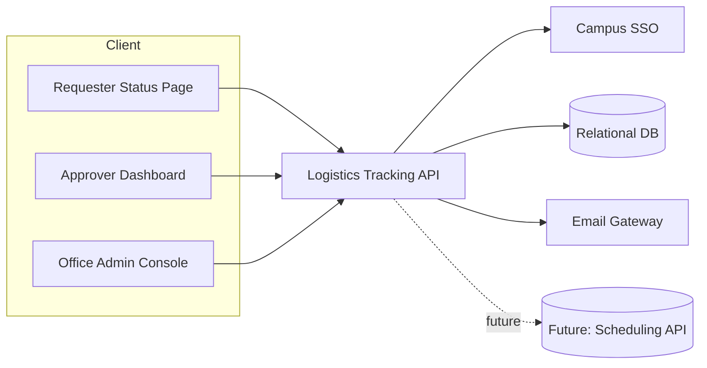
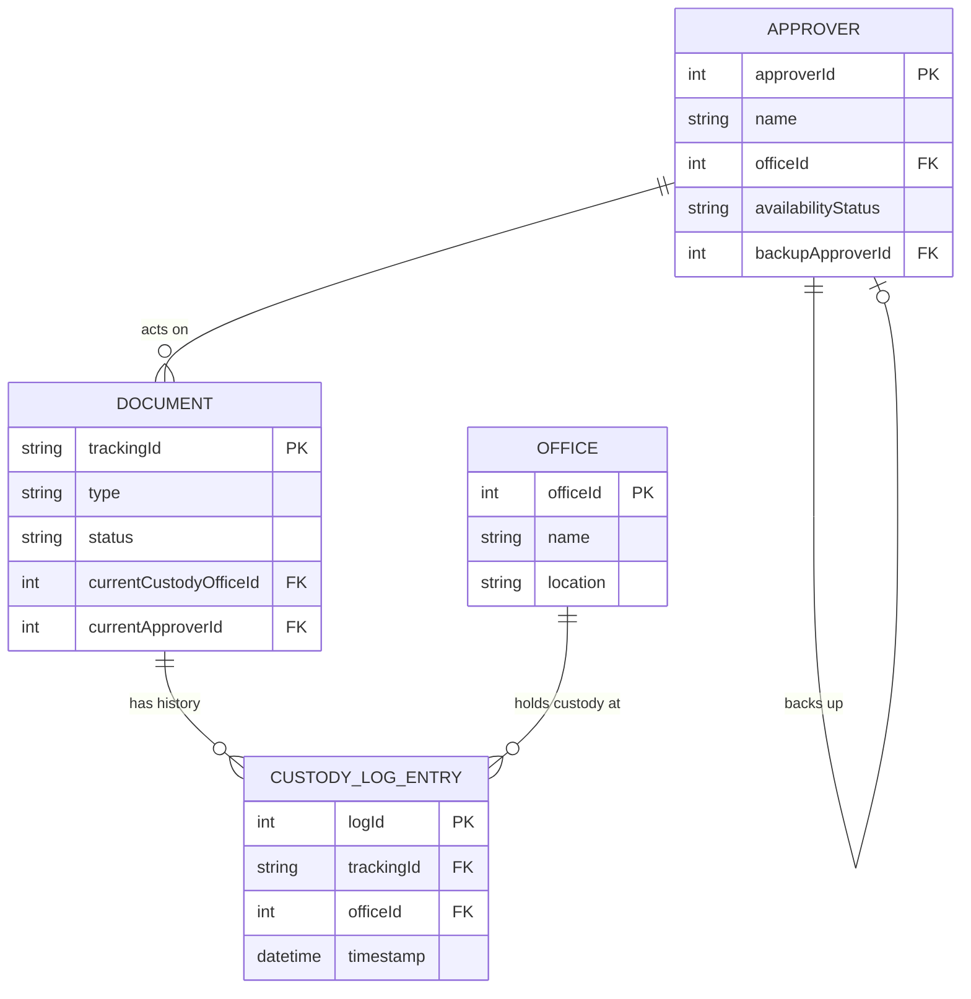
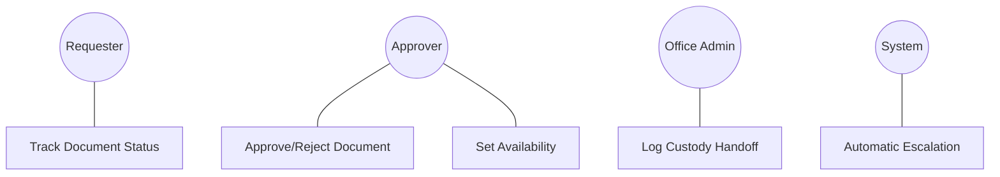
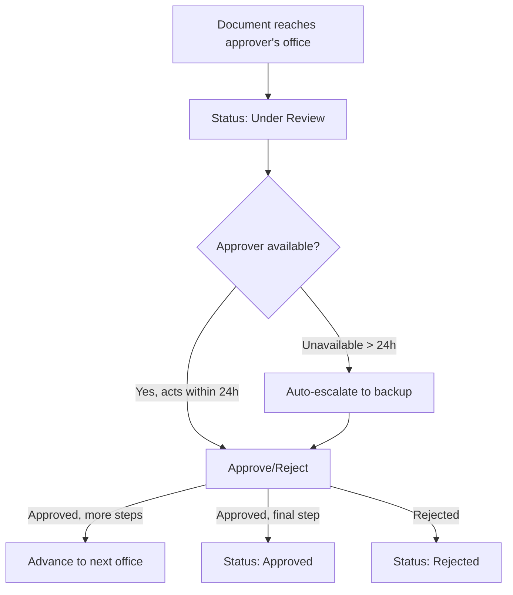
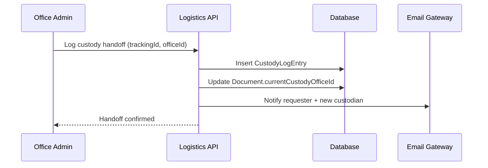
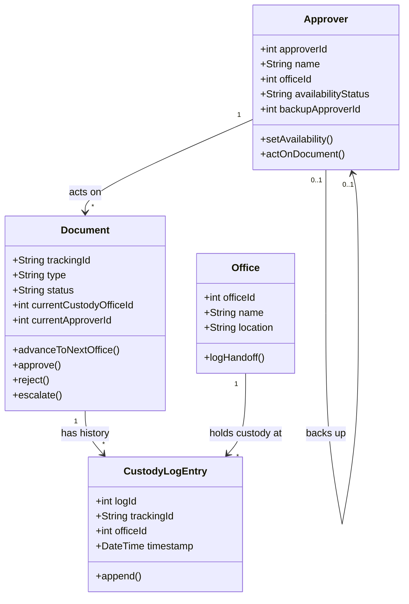

# Software Requirements Specification

**Smart Campus Logistics System (Document Custody & Approval Tracker)**

**Version:** 1.0
**Prepared For:** CPE 304/304L — Software Design
**Prepared By:** Group 2-1
**Instructor:** Engr. William C. Dionisio
**Classification:** Academic Submission Copy

---

## Revision History

| Date | Description | Author | Comments |
| --- | --- | --- | --- |
| 2026-11-03 | Version 1.0 | Group 2-1 | Initial SRS draft, derived from Requirements Engineering Workshop |

## Document Approval

| Signature | Printed Name | Title | Date |
| --- | --- | --- | --- |
| | Group 2-1 | Development Team | |
| | Engr. William C. Dionisio | Instructor, CPE 304/304L | |

---

## Table of Contents

1. [Introduction](#1-introduction)
2. [General Description](#2-general-description)
3. [Specific Requirements](#3-specific-requirements)
4. [Analysis Models](#4-analysis-models)
5. [Appendices](#a-appendices)

---

## 1. Introduction

### 1.1 Purpose

This Software Requirements Specification (SRS) defines the requirements of the **Smart Campus Logistics System**, a digital custody and approval-tracking platform for inter-office document routing at the university. It is written for the development team and the course instructor, and formalizes the problem statement and requirements produced in the group's Requirements Engineering Workshop (see `docs/02-requirements-workshop/requirements_engineering_workshop.md`).

### 1.2 Scope

The system shall:

1. Be named the **Smart Campus Logistics System** (internally, the "Document Custody Tracker").
2. Provide real-time visibility into which office currently holds a routed document, when it arrived there, and when custody will next transfer.
3. Track approver availability (On-Campus, Off-Campus, Away, Designated Backup) and automatically escalate a pending approval to a backup signer if the primary approver is unavailable for more than 24 hours.
4. Notify requesters and current custodians of status changes.

The system will **not** replace the underlying approval *authority* or workflow policy — i.e., it does not decide who is allowed to approve what; it only makes the existing multi-office paper-routing process visible, trackable, and escalation-capable. Physical document transport itself (the act of walking a folder between offices) remains manual; the system tracks that transport, it does not automate it.

**Root cause addressed:** the university lacks a centralized digital custody log and approver-availability system, so document location and approver availability are invisible to everyone except whoever physically holds the paper — causing multi-day delays with no escalation path when a signatory is traveling or off-campus.

### 1.3 Definitions, Acronyms, and Abbreviations

| Term | Definition |
| --- | --- |
| Document | A physical routing item (e.g., a signature/approval slip) tracked by the system from submission to final disposition. |
| Custody | The office currently physically holding a document. |
| Custody Log | An immutable, timestamped record of every office that has held a document and when. |
| Approver | A faculty/staff member authorized to approve or reject a document at a given step. |
| Backup Signer | A designated alternate approver who can act when the primary approver is unavailable. |
| Escalation | The automatic re-routing of a pending approval to the backup signer after the unavailability threshold is exceeded. |
| SSO | University Single Sign-On identity service. |

### 1.4 References

1. IEEE Guide to Software Requirements Specifications, ANSI/IEEE Std. 830-1984.
2. `docs/02-requirements-workshop/requirements_engineering_workshop.md` — Group 2-1's 5 Whys analysis, problem statement, and draft functional/non-functional requirements for this system.
3. CPE 304/304L SRS Template, Engr. William C. Dionisio.

### 1.5 Overview

Section 2 frames the problem in context. Section 3 gives the specific, verifiable functional and non-functional requirements. Section 4 presents analysis models (architecture, data, use case, activity, and sequence views). Appendices carry the workshop's root-cause analysis for traceability.

---

## 2. General Description

### 2.1 Product Perspective

The system is a new, standalone addition to campus administrative operations; it does not replace an existing IT system, only the paper routing-slip process. It is expected to eventually integrate with the university's scheduling/calendar systems to auto-detect approver availability, but for v1 availability is set manually by office administrators.

### 2.2 Product Features

- Unique tracking ID and real-time status per document (Submitted, In Transit, Under Review, Approved, Rejected).
- Dashboard showing current custodian office, current approver, and approver availability.
- Immutable custody log of every office handoff with timestamps.
- Automatic escalation to a backup approver after 24 hours of primary-approver unavailability.
- Email/dashboard notifications to requester and current custodian on every status change.

### 2.3 User Characteristics

- **Requesters** (any faculty/staff/student submitting a document) need only enough familiarity to check a status page using a tracking ID; no special training required.
- **Approvers** (faculty/department heads/administrators) need to view a queue of documents awaiting their action and set their own availability status.
- **Office Administrators** at each office node update their office's handoff status and, until calendar integration exists, manually set approver availability.

### 2.4 General Constraints

- The system must authenticate all users via university SSO.
- The system must operate within existing campus office hours (8 AM–5 PM) for guaranteed responsiveness, while remaining reachable (with delayed sync accepted) outside those hours.
- The system shall not require changes to existing approval authority or workflow procedures — only to how custody and availability are tracked.

### 2.5 Assumptions and Dependencies

- It is assumed each office designates at least one backup approver for every approval role before go-live; if no backup exists, escalation cannot occur and the document will remain flagged as blocked.
- It is assumed office administrators will update approver availability by 6 AM daily (manually, until a scheduling-system integration exists); stale availability data is accepted as a known limitation of v1.
- It is assumed physical handoff between offices continues to be performed by people, with the system only recording when a handoff is logged as scanned/confirmed.

---

## 3. Specific Requirements

### 3.1 External Interface Requirements

#### 3.1.1 User Interfaces

- A requester-facing status lookup page (tracking ID → current status, custody, and history).
- An approver dashboard listing documents awaiting their action, with one-click approve/reject and an availability toggle.
- An office administrator console to log custody handoffs and manage backup-approver assignments.

#### 3.1.2 Hardware Interfaces

- None required for v1; a barcode/QR scanner at each office desk is an optional future enhancement to speed up handoff logging (see Appendix A.1).

#### 3.1.3 Software Interfaces

- University SSO for authentication.
- Email gateway for notifications.
- (Future) Integration with a campus scheduling/calendar API to auto-populate approver availability — not required for v1.

#### 3.1.4 Communications Interfaces

- All traffic shall use HTTPS/TLS.
- Custody logs shall be encrypted at rest (AES-256) in addition to in transit (TLS).

### 3.2 Functional Requirements

#### 3.2.1 Document Submission and Tracking ID Assignment

- **3.2.1.1 Introduction:** Gives every routed document a unique, trackable identity.
- **3.2.1.2 Inputs:** Document type, requester identity, originating office, destination approval chain.
- **3.2.1.3 Processing:** The system generates a unique tracking ID and initializes status to "Submitted," with the originating office as first custodian.
- **3.2.1.4 Outputs:** Tracking ID returned to the requester; initial custody log entry created.
- **3.2.1.5 Error Handling:** Reject submission if the approval chain references an office or approver that does not exist in the system.

#### 3.2.2 Custody Handoff Logging

- **3.2.2.1 Introduction:** Records every physical transfer of a document between offices.
- **3.2.2.2 Inputs:** Tracking ID, receiving office, timestamp (defaults to now).
- **3.2.2.3 Processing:** The system appends an immutable custody log entry and updates the document's current-custodian field; status moves to "In Transit" between offices or "Under Review" once it reaches an approver's office.
- **3.2.2.4 Outputs:** Updated status visible on the dashboard within 5 seconds.
- **3.2.2.5 Error Handling:** Reject a logged handoff to an office that is not the next step in the defined approval chain, flagging it for administrator review rather than silently accepting it.

#### 3.2.3 Approver Availability Management

- **3.2.3.1 Introduction:** Captures whether an approver can act on documents right now.
- **3.2.3.2 Inputs:** Approver identity, availability status (On-Campus, Off-Campus, Away, Designated Backup active).
- **3.2.3.3 Processing:** The system stores the latest availability per approver, timestamped; office administrators or the approver themselves may update it.
- **3.2.3.4 Outputs:** Availability shown on the dashboard next to any document awaiting that approver.
- **3.2.3.5 Error Handling:** If no availability update has been made in the current day, the system shall display "Unknown" rather than assuming availability.

#### 3.2.4 Approval Action

- **3.2.4.1 Introduction:** Lets an approver act on a document.
- **3.2.4.2 Inputs:** Tracking ID, decision (Approve/Reject), optional comment.
- **3.2.4.3 Processing:** The system updates document status to "Approved," "Rejected," or advances it to the next office in the chain.
- **3.2.4.4 Outputs:** Notification to requester and next custodian (if any).
- **3.2.4.5 Error Handling:** Reject an approval action submitted by anyone other than the currently assigned approver or their active backup.

#### 3.2.5 Automatic Escalation to Backup Signer

- **3.2.5.1 Introduction:** Prevents indefinite stalling when a primary approver is unavailable.
- **3.2.5.2 Inputs:** None (system-triggered); depends on the primary approver's availability status and elapsed time since the document reached "Under Review" at their desk.
- **3.2.5.3 Processing:** If the primary approver has been marked unavailable (Off-Campus/Away) for more than 24 continuous hours while a document awaits their action, the system shall automatically reassign the pending approval to the designated backup signer.
- **3.2.5.4 Outputs:** Notification to the backup signer, the requester, and the original approver that escalation occurred.
- **3.2.5.5 Error Handling:** If no backup signer is configured, the system shall flag the document as "Blocked — No Backup Available" and notify the office administrator rather than silently failing.

#### 3.2.6 Status Lookup

- **3.2.6.1 Introduction:** Lets a requester check progress without calling around.
- **3.2.6.2 Inputs:** Tracking ID.
- **3.2.6.3 Processing:** The system retrieves current status, current custodian, current approver and their availability, and the full custody history.
- **3.2.6.4 Outputs:** A status page/screen.
- **3.2.6.5 Error Handling:** Return a clear "tracking ID not found" message for invalid IDs.

### 3.3 Use Cases

#### 3.3.1 Use Case: Track a Submitted Document

- **Actor:** Requester
- **Precondition:** Document has been submitted and has a tracking ID.
- **Main Flow:** Requester enters tracking ID → system displays current status, custodian, approver availability, and history.

#### 3.3.2 Use Case: Approve or Reject a Document

- **Actor:** Approver
- **Precondition:** Document is "Under Review" at the approver's office; approver is authenticated.
- **Main Flow:** Approver opens their queue → selects document → approves or rejects with optional comment → system updates status and notifies stakeholders.

#### 3.3.3 Use Case: Automatic Escalation

- **Actor:** System (triggered), Backup Signer
- **Precondition:** Primary approver unavailable > 24 hours with a pending document.
- **Main Flow:** System detects the elapsed unavailability → reassigns the approval task to the backup signer → notifies all parties.

#### 3.3.4 Use Case: Log a Custody Handoff

- **Actor:** Office Administrator
- **Precondition:** Document physically arrives at the office.
- **Main Flow:** Administrator scans/enters the tracking ID → confirms receipt → system appends a custody log entry and updates status.

### 3.4 Classes / Objects

#### 3.4.1 Document

- **3.4.1.1 Attributes:** `trackingId`, `type`, `requesterId`, `status`, `currentCustodyOfficeId`, `currentApproverId`.
- **3.4.1.2 Functions:** `advanceToNextOffice()`, `approve()`, `reject()`, `escalate()`. Reference: 3.2.1, 3.2.4, 3.2.5.

#### 3.4.2 CustodyLogEntry

- **3.4.2.1 Attributes:** `logId`, `trackingId`, `officeId`, `timestamp`.
- **3.4.2.2 Functions:** `append()` (append-only; no update/delete). Reference: 3.2.2.

#### 3.4.3 Approver

- **3.4.3.1 Attributes:** `approverId`, `name`, `officeId`, `availabilityStatus`, `backupApproverId`.
- **3.4.3.2 Functions:** `setAvailability()`, `actOnDocument()`. Reference: 3.2.3, 3.2.4.

#### 3.4.4 Office

- **3.4.4.1 Attributes:** `officeId`, `name`, `location`.
- **3.4.4.2 Functions:** `logHandoff()`. Reference: 3.2.2.

### 3.5 Non-Functional Requirements

#### 3.5.1 Performance

- Status updates shall be reflected on dashboards within 5 seconds of a handoff or decision being logged.

#### 3.5.2 Reliability

- The custody log shall be append-only and immutable; no API shall permit editing or deleting a historical entry.

#### 3.5.3 Availability

- The system shall maintain at least 99% uptime during office hours (8 AM–5 PM); delayed sync is acceptable outside those hours.

#### 3.5.4 Security

- All users shall authenticate through university SSO.
- Custody logs shall be encrypted in transit (TLS) and at rest (AES-256).
- Only the assigned approver or their active backup may record an approval decision for a given document.

#### 3.5.5 Maintainability

- The 24-hour escalation threshold shall be a configurable value, not hard-coded.

#### 3.5.6 Portability

- The dashboard shall be accessible from any modern browser on desktop and mobile, since approvers are often off-campus when they need to check or update status.

### 3.6 Inverse Requirements

- The system shall **not** allow a document's approval chain to be altered once routing has begun, except by an office administrator with an explicit, logged override — to preserve the integrity of the custody trail.

### 3.7 Design Constraints

- The system shall not require changes to existing approval authority or workflow procedures (per the workshop's non-functional requirement) — it augments visibility, it does not redesign who approves what.
- Approver availability shall update on a daily cadence (6 AM) absent a live calendar integration.

### 3.8 Logical Database Requirements

A relational database with append-only semantics on the custody log table is required. Core tables: `document`, `custody_log_entry`, `approver`, `office`. Custody log entries must never be updated or deleted after insertion; retention is indefinite for audit purposes.

### 3.9 Other Requirements

- The system shall notify both the requester and the current custodian via email and/or dashboard alert on every status transition.

---

## 4. Analysis Models

### 4.1 Architecture Design

### 4.2 Database Design

Core tables: `document`, `custody_log_entry` (append-only), `approver`, `office`. `document.current_custody_office_id` and `document.current_approver_id` are denormalized pointers kept in sync by every handoff/decision transaction, while `custody_log_entry` preserves full history.

### 4.3 Entity Relationship (ER) Diagram

### 4.4 Use Case Model Survey

Primary actors: **Requester**, **Approver**, **Office Administrator**, and the **System** itself (as the actor triggering automatic escalation). Use cases are listed in Section 3.3.

### 4.5 Use Case Diagrams

### 4.6 Activity Diagrams

### 4.7 Sequence Diagrams

### 4.8 Class Diagrams

---

## A. Appendices

### A.1 Workshop Traceability

This SRS formalizes the 5 Whys root-cause analysis and structured problem statement produced in the Requirements Engineering Workshop:

> **Approving officers (faculty and staff)** need a way to **track document location, identify when primary approvers are unavailable, and automatically escalate to designated backup signers** because **the current paper-based routing process provides no visibility into either document custody or signer availability**, causing cascading delays when key personnel are traveling or off-campus with no escalation mechanism.

See `docs/02-requirements-workshop/requirements_engineering_workshop.md` for the full 5 Whys trace, impact/uncertainty scoring, and fact/assumption validation that this SRS is built on.

### A.2 Future Enhancements

- Barcode/QR scanning hardware at office desks to speed up handoff logging and reduce manual entry error.
- Live integration with a campus scheduling/calendar system to auto-populate approver availability instead of daily manual entry.
