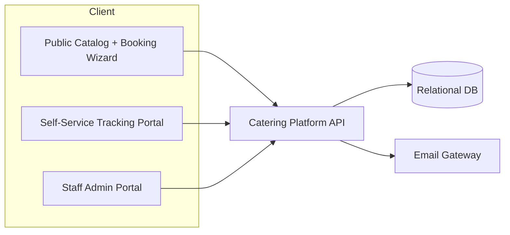
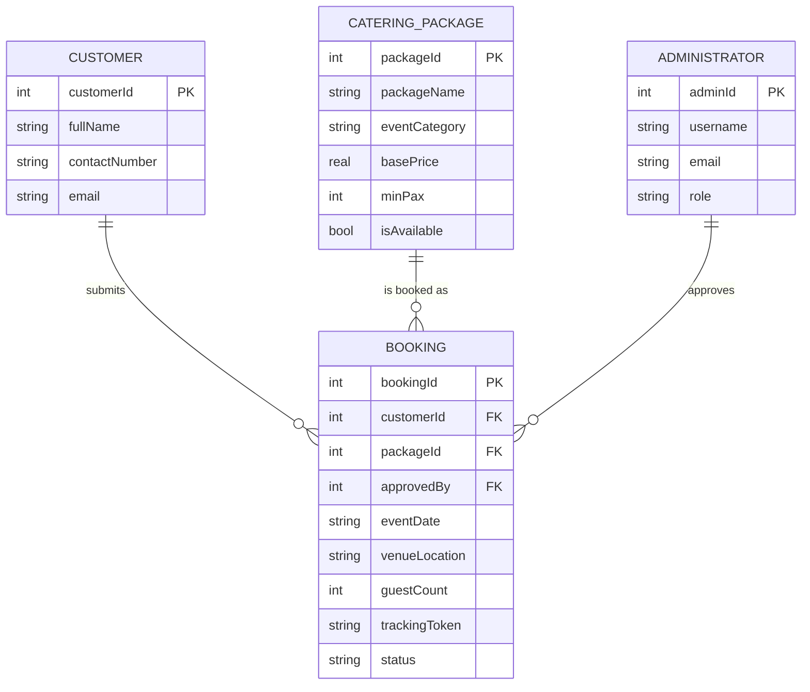
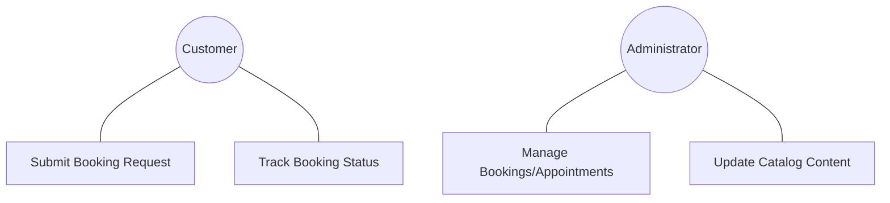
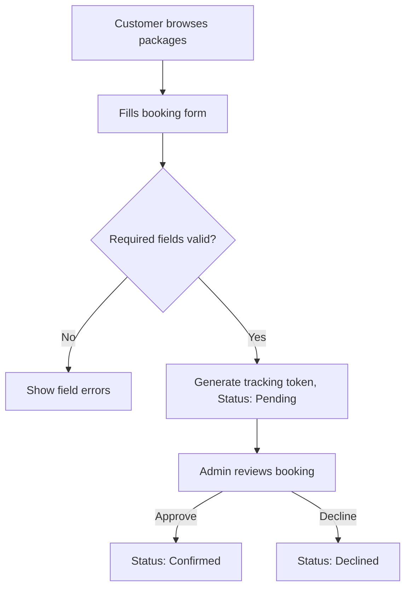
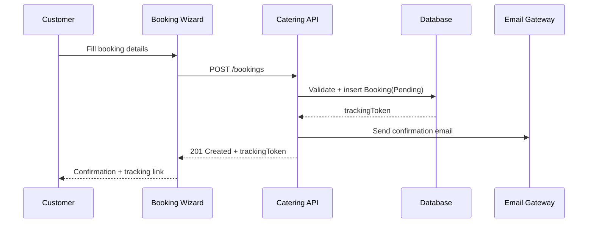
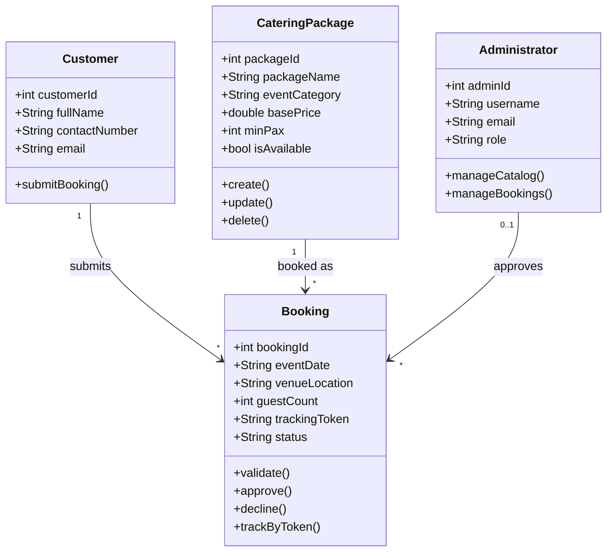

# Software Requirements Specification

**Stella's Event Management Services Website**

**Version:** 1.0
**Prepared For:** Casa de Stella Catering Services
**Prepared By:** Group 2-1 — Lopez, Cyrus Angelo S.; Roque, Francis Benedict S.; Santos, John Carlo; Santos, Mark Kean G.
**Prepared for Course:** CPE 304/304L — Software Design
**Instructor:** Engr. William C. Dionisio
**Classification:** Client Approval Copy

---

## Revision History

| Date | Description | Author | Comments |
| --- | --- | --- | --- |
| 2026-11-03 | Version 1.0 | Group 2-1 | Reformatted to CPE 304/304L SRS template; content converted from client PDF |

## Document Approval

| Signature | Printed Name | Title | Date |
| --- | --- | --- | --- |
| | Casa de Stella Catering Services | Client / Business Owner | |
| | Group 2-1 | Development Team | |
| | Engr. William C. Dionisio | Instructor, CPE 304/304L | |

---

## Table of Contents

1. [Introduction](#1-introduction)
2. [General Description](#2-general-description)
3. [Specific Requirements](#3-specific-requirements)
4. [Analysis Models](#4-analysis-models)
5. [Appendices](#a-appendices)

---

## 1. Introduction

### 1.1 Purpose

This Software Requirements Specification (SRS) defines the complete requirements of the Stella's Event Management Services Website, a web-based platform developed to promote the catering services offered by Casa de Stella Catering Services and to give customers a convenient way to explore available catering packages and submit booking requests. This document serves as a formal agreement between Stella's Event Management Services and the development team, a reference for design/implementation/testing/deployment, a guide for maintenance and future enhancements, and the basis for validating that the delivered system meets the business requirements of Casa de Stella Catering Services.

### 1.2 Scope

**Product:** Stella's Event Management Services Website (a public catalog + booking site, with an administrator back office).

**What it will do:**

- Promote catering services; display packages, pricing, menus, and event-design galleries.
- Allow customers to submit booking requests and schedule appointments/consultations without creating an account.
- Allow customers to describe their preferred event theme/design and optionally upload a reference image.
- Allow administrators to manage website content, pricing, bookings, and appointments through a secure dashboard.

**What it will not do:** process online payments, manage physical kitchen inventory in real time, replace existing accounting software, or act as a social media management platform.

**Root cause addressed:** Stella's currently handles inquiries and reservations manually (phone, social media, walk-ins), which causes delayed responses, inconsistent access to pricing/menu information, inefficient appointment scheduling, and growing administrative workload as inquiry volume increases. The fundamental root cause is the absence of a centralized web-based platform for service information and booking management; this website addresses that directly.

### 1.3 Definitions, Acronyms, and Abbreviations

| Term | Definition |
| --- | --- |
| Booking | A customer-submitted request for catering services tied to a specific event date, venue, and package. |
| Appointment | A scheduled consultation between the customer and the Events Manager, distinct from the booking itself. |
| Package | A pre-defined bundle of catering inclusions (food, service, décor baseline) offered at a base price. |
| CMS | Content Management — the admin capability to add/edit/delete packages, menu items, and gallery content. |
| RBAC | Role-Based Access Control. |

### 1.4 References

1. IEEE Guide to Software Requirements Specifications, ANSI/IEEE Std. 830-1984.
2. CPE 304/304L SRS Template, Engr. William C. Dionisio.
3. Client-provided requirements document (PDF) from Casa de Stella Catering Services, converted to this SRS.

### 1.5 Overview

Section 2 describes the product and its context without stating testable requirements. Section 3 states the verifiable functional and non-functional requirements, external interfaces, use cases, data requirements, business rules, and system constraints. Section 4 presents analysis models. Appendices carry acceptance criteria, risks/mitigations, and future enhancements that supplement — but are not themselves — core requirements.

---

## 2. General Description

### 2.1 Product Perspective

The website is a new, standalone platform for Casa de Stella Catering Services; it does not replace any existing software (the business currently has no dedicated system), only the manual phone/social-media/walk-in process.

### 2.2 Product Features

- Service/package catalog with pricing, inclusions, and event-design galleries (weddings, birthdays, corporate events).
- Guest (no-account-required) booking request submission with event details and customization notes/images.
- Appointment scheduling and status tracking (Pending/Confirmed/Declined).
- Administrator CMS for packages, menu items, pricing, galleries, and announcements.
- Administrator booking/appointment management (approve, decline, reschedule).

### 2.3 User Characteristics

- **Customers/Guests** are the general public with no assumed technical skill beyond using a web browser; they are not required to create an account.
- **Administrators** (business owner, Events Manager, Logistics Coordinator, Kitchen/Food Manager, Site Administrator) use the dashboard regularly and are assumed to have basic familiarity with web back-office tools but no programming background.

### 2.4 General Constraints

- The system shall operate as a web application accessible via any modern browser (Chrome, Edge, Firefox, Safari).
- The system shall require a stable internet connection for both customers and administrators.
- The system shall use a relational database to store content, bookings, appointments, customization requests, and uploaded reference images.

### 2.5 Assumptions and Dependencies

- It is assumed customers will provide accurate event details (date, venue, guest count); booking accuracy depends on this input and is not independently verified by the system.
- It is assumed scheduled maintenance will be performed during off-business hours wherever possible.
- It is assumed uploaded reference images are limited to supported formats and a maximum file size, enforced at upload time.

---

## 3. Specific Requirements

### 3.1 External Interface Requirements

#### 3.1.1 User Interfaces

- A responsive public site (mobile/tablet/desktop) presenting packages, menus, galleries, and the booking/appointment flow.
- An administrator dashboard for CMS, bookings, and appointments.

#### 3.1.2 Hardware Interfaces

- None beyond a standard client device capable of running a modern web browser.

#### 3.1.3 Software Interfaces

- Standard email systems, for booking/appointment notifications.
- Modern web browsers (Chrome, Edge, Firefox, Safari).

#### 3.1.4 Communications Interfaces

- All traffic shall use HTTPS/TLS.

### 3.2 Functional Requirements

#### 3.2.1 Booking Management

- **3.2.1.1 Introduction:** Lets customers submit catering booking requests.
- **3.2.1.2 Inputs:** Customer contact info, event date, venue, guest count, selected package, optional design notes/reference image.
- **3.2.1.3 Processing:** The system validates required fields (date, venue, guest count), generates a unique booking identifier, and records a submission timestamp.
- **3.2.1.4 Outputs:** A confirmed booking record with a unique tracking number; a confirmation notification.
- **3.2.1.5 Error Handling:** Reject submission with field-level errors if required fields (date, venue, guest count) are missing or invalid.

  - **FR-001:** The system shall automatically generate a unique booking identifier.
  - **FR-002:** The system shall record the timestamp of booking submissions.
  - **FR-003:** The system shall validate required fields (Date, Venue, Guest Count).

#### 3.2.2 Appointment Scheduling

- **3.2.2.1 Introduction:** Lets customers request a consultation appointment and lets staff manage it.
- **3.2.2.2 Inputs:** Requested date/time.
- **3.2.2.3 Processing:** The system records the request with status Pending, and allows administrators to confirm, decline, or reschedule.
- **3.2.2.4 Outputs:** Appointment status visible to both customer and administrator.
- **3.2.2.5 Error Handling:** N/A beyond standard required-field validation.

  - **FR-004:** The system shall allow customers to request specific appointment dates/times.
  - **FR-005:** The system shall display appointment status (Pending, Confirmed, Declined).
  - **FR-006:** The system shall allow administrators to reschedule appointments.

#### 3.2.3 Content Management (CMS)

- **3.2.3.1 Introduction:** Lets administrators keep catalog content current.
- **3.2.3.2 Inputs:** Package details, menu items, pricing, gallery images.
- **3.2.3.3 Processing:** The system applies create/edit/delete operations to the relevant catalog tables.
- **3.2.3.4 Outputs:** Updated public catalog, reflected immediately.
- **3.2.3.5 Error Handling:** Reject duplicate package names (unique constraint) with a clear message.

  - **FR-007:** The system shall allow administrators to add/edit/delete catering packages.
  - **FR-008:** The system shall allow administrators to update food menu items and pricing.
  - **FR-009:** The system shall support image uploads for event design galleries.

#### 3.2.4 Notification System

- **3.2.4.1 Introduction:** Keeps customers and staff informed of state changes.
- **3.2.4.2 Inputs:** Booking/appointment status transitions.
- **3.2.4.3 Processing:** The system generates a notification for each transition.
- **3.2.4.4 Outputs:** Notification delivered via email and/or dashboard.
- **3.2.4.5 Error Handling:** N/A.

  - **FR-010:** The system shall generate notifications for new booking requests, appointment confirmation/updates, and admin inquiries.

#### 3.2.5 Search and Filter

- **3.2.5.1 Introduction:** Helps customers find relevant packages quickly.
- **3.2.5.2 Inputs:** Event type filter.
- **3.2.5.3 Processing:** The system filters the package catalog by event category.
- **3.2.5.4 Outputs:** Filtered package list with pricing.
- **3.2.5.5 Error Handling:** Show an empty-state message if no packages match the filter.

  - **FR-011:** The system shall allow customers to filter catering packages by event type.
  - **FR-012:** The system shall allow customers to view pricing details for all services.

### 3.3 Use Cases

#### 3.3.1 Use Case: Submit a Booking Request

- **Actor:** Customer/Guest
- **Precondition:** None (no account required).
- **Main Flow:** Customer browses packages → selects a package → fills in event details and optional design notes/image → submits → receives a unique tracking number and confirmation.

#### 3.3.2 Use Case: Manage Bookings and Appointments

- **Actor:** Administrator (Events Manager)
- **Precondition:** Administrator is authenticated.
- **Main Flow:** Administrator opens the dashboard → reviews pending bookings/appointments → approves, declines, or reschedules → customer is notified.

#### 3.3.3 Use Case: Update Catalog Content

- **Actor:** Administrator (Site Administrator)
- **Precondition:** Administrator is authenticated.
- **Main Flow:** Administrator opens the CMS → adds/edits/removes a package, menu item, or gallery image → change is live on the public site.

### 3.4 Classes / Objects

#### 3.4.1 Customer

- **3.4.1.1 Attributes:** `customerId`, `fullName`, `contactNumber`, `email`.
- **3.4.1.2 Functions:** `submitBooking()`. Reference: 3.2.1.

#### 3.4.2 CateringPackage

- **3.4.2.1 Attributes:** `packageId`, `packageName`, `eventCategory`, `basePrice`, `minPax`, `isAvailable`, `inclusions`.
- **3.4.2.2 Functions:** `create()`, `update()`, `delete()`. Reference: 3.2.3.

#### 3.4.3 Booking

- **3.4.3.1 Attributes:** `bookingId`, `customerId`, `packageId`, `approvedBy`, `eventDate`, `venueLocation`, `guestCount`, `designThemeNotes`, `referenceImageUrl`, `trackingToken`, `status`.
- **3.4.3.2 Functions:** `validate()`, `approve()`, `decline()`, `trackByToken()`. Reference: 3.2.1, 3.3.1.

#### 3.4.4 Administrator

- **3.4.4.1 Attributes:** `adminId`, `username`, `email`, `role`.
- **3.4.4.2 Functions:** `manageCatalog()`, `manageBookings()`. Reference: 3.2.2, 3.2.3.

### 3.5 Non-Functional Requirements

#### 3.5.1 Performance

- **NFR-001:** Page loading time shall not exceed 3 seconds.
- **NFR-002:** The system shall support at least 100 concurrent users.

#### 3.5.2 Reliability

- All booking status changes shall be logged (see Business Rules, Section 3.9).

#### 3.5.3 Availability

- **NFR-003:** System availability shall be at least 99.9%.

#### 3.5.4 Security

- **NFR-004:** All sensitive customer data shall be encrypted (HTTPS/TLS).
- **NFR-005:** Role-Based Access Control (RBAC) shall be enforced for the dashboard.

#### 3.5.5 Maintainability

- Package pricing and inclusions shall be editable by administrators without a code deployment.

#### 3.5.6 Portability

- The site shall be responsive across mobile, tablet, and desktop viewports.

### 3.6 Inverse Requirements

- The system shall **not** require customers to create an account before submitting a booking request or scheduling an appointment.
- The system shall **not** process online payments directly (see Section 1.2 exclusions).

### 3.7 Design Constraints

- The system shall support secure file uploads for customer-submitted reference images, limited to supported formats and a maximum file size.
- The system shall comply with current web security standards (HTTPS, secure authentication, protection against unauthorized access).
- Only authorized administrators shall have access to the administrative dashboard.

### 3.8 Logical Database Requirements

A relational database is required. Core entities: `Customer`, `CateringPackage`, `Booking`, `Administrator`. Every `Booking` references exactly one `Customer` and one `CateringPackage`, and optionally the `Administrator` who approved it. Booking tracking tokens must be unique. All booking status changes must be logged (BR-004).

### 3.9 Other Requirements

**Business Rules:**

- **BR-001:** Every booking must have a unique tracking number.
- **BR-002:** Booking requests must be submitted at least 7 days before the event.
- **BR-003:** Unauthorized users cannot access the administrative dashboard.
- **BR-004:** All booking status changes must be logged.
- **BR-005:** Only authorized administrators can update package pricing.

---

## 4. Analysis Models

### 4.1 Architecture Design

### 4.2 Database Design

Core tables (as implemented in `backend/src/db/schema.ts`): `customer`, `catering_package`, `administrator`, `booking`. `booking` references `customer` and `catering_package` (restricted delete) and optionally `administrator` (nullable `approved_by`).

### 4.3 Entity Relationship (ER) Diagram

### 4.4 Use Case Model Survey

Primary actors: **Customer/Guest** and **Administrator** (Events Manager, Site Administrator, Logistics Coordinator, Kitchen/Food Manager as specialized roles). Use cases are listed in Section 3.3.

### 4.5 Use Case Diagrams

### 4.6 Activity Diagrams

### 4.7 Sequence Diagrams

### 4.8 Class Diagrams

---

## A. Appendices

### A.1 Acceptance Criteria

- **AC-01:** Customers can browse catering packages, menus, pricing, brochures, and event galleries seamlessly.
- **AC-02:** Customers can submit booking requests without creating an account.
- **AC-03:** Customers can schedule appointments and provide complete event details.
- **AC-04:** Customers can submit design descriptions and optionally upload reference images without errors.
- **AC-05:** Administrators can securely log in and manage packages, menus, pricing, galleries, bookings, appointments, and content.
- **AC-06:** The system correctly stores and displays all submitted booking requests and customization details.
- **AC-07:** Security testing confirms only authorized administrators can access the dashboard and sensitive functions.

### A.2 Risks and Mitigation

| Risk | Mitigation |
| --- | --- |
| Internet connectivity issues | Reliable web hosting, optimized performance. |
| Unauthorized access to the admin dashboard | Secure authentication, strong passwords, RBAC. |
| Loss of customer booking information | Automated database backups and recovery procedures. |
| Upload of unsupported/malicious image files | Validate file types, restrict file sizes, scan uploads. |
| Incorrect customer booking information | Mandatory input validation and confirmation before submission. |
| Website downtime due to server failure | Reliable hosting with monitoring and backup servers. |

### A.3 Future Enhancements

- Online payment integration for deposits/full payments.
- Customer account registration for booking history.
- SMS/email confirmation services, live chat support, interactive booking calendar.
- AI-powered package/theme recommendations.
- Mobile application; feedback/review management; social media integration; analytics dashboard.
