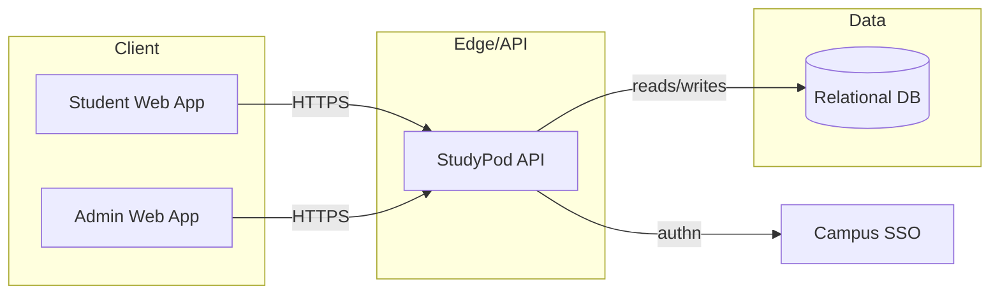
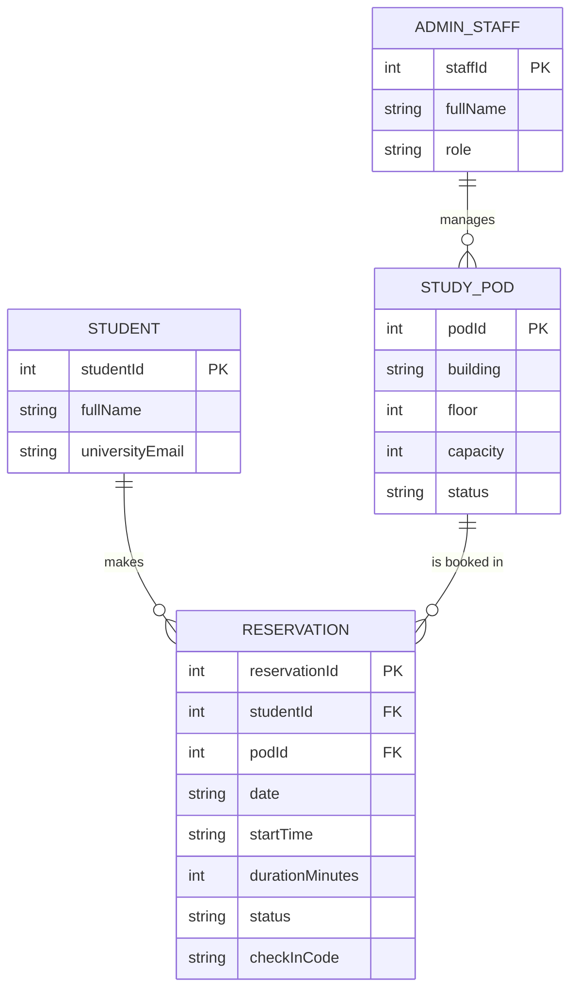
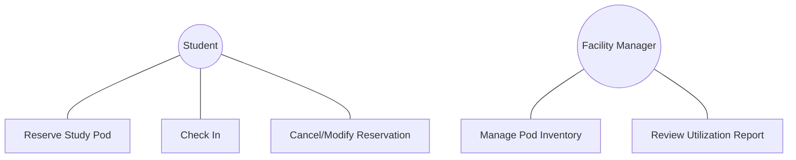
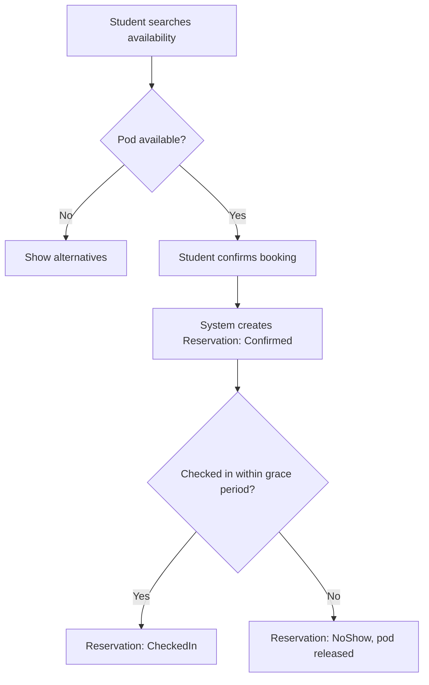
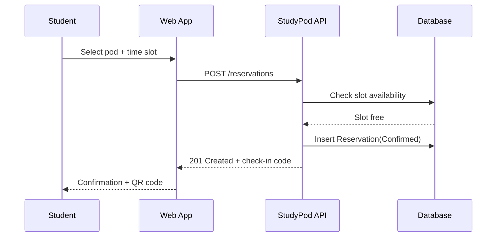
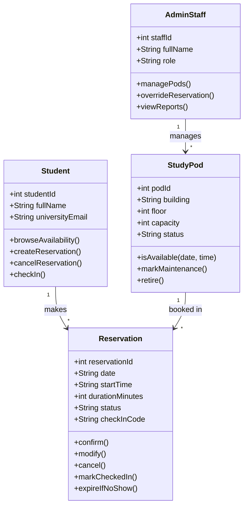

# Software Requirements Specification

**Study Pod Reservation System**

**Version:** 1.0
**Prepared For:** CPE 304/304L — Software Design
**Prepared By:** Group 2-1
**Instructor:** Engr. William C. Dionisio
**Classification:** Academic Submission Copy

---

## Revision History

| Date | Description | Author | Comments |
| --- | --- | --- | --- |
| 2026-11-03 | Version 1.0 | Group 2-1 | Initial SRS draft |

## Document Approval

| Signature | Printed Name | Title | Date |
| --- | --- | --- | --- |
| | Group 2-1 | Development Team | |
| | Engr. William C. Dionisio | Instructor, CPE 304/304L | |

---

## Table of Contents

1. [Introduction](#1-introduction)
2. [General Description](#2-general-description)
3. [Specific Requirements](#3-specific-requirements)
4. [Analysis Models](#4-analysis-models)
5. [Appendices](#a-appendices)

---

## 1. Introduction

### 1.1 Purpose

This Software Requirements Specification (SRS) defines the functional and non-functional requirements of the **Study Pod Reservation System (StudyPod)**, a web-based application that lets students reserve individual or small-group study pods inside campus libraries and learning commons. The intended audience is the development team, the course instructor acting as evaluator, and any future maintainer who needs a complete description of the external behavior of the system.

### 1.2 Scope

StudyPod shall be produced as a single web application with a student-facing booking interface and a staff-facing administration console. The software will:

- Allow students to browse study pod availability by building, floor, capacity, and time slot.
- Allow students to create, modify, and cancel pod reservations within policy limits.
- Enforce a check-in window so that no-show reservations are automatically released back into the available pool.
- Allow library staff to manage the pod inventory (add/retire pods, mark pods under maintenance) and to view/override reservations.
- Provide usage reporting so library administration can see pod utilization trends.

StudyPod will **not** handle physical door locking/unlocking hardware integration, general library seating (open-plan desks), or payment processing — reservations are free to enrolled students. These are explicitly out of scope for this version.

The goal is to replace the current first-come-first-served, walk-up-only allocation of study pods — which causes long queues at peak hours and pods sitting empty because students can't see availability remotely — with a predictable, remotely visible booking system that improves pod utilization and reduces time students spend searching for a place to study.

### 1.3 Definitions, Acronyms, and Abbreviations

| Term | Definition |
| --- | --- |
| Pod | A single enclosed or partitioned study space, individual or group-capacity, located inside a campus library/learning commons. |
| Reservation | A confirmed booking of one pod for one student (or group representative) for a specific date and time slot. |
| Check-in | The act of confirming physical arrival at a reserved pod within the grace period, via QR code scan or kiosk PIN entry. |
| No-show | A reservation for which check-in did not occur within the grace period. |
| Grace Period | The window (default 10 minutes) after a reservation's start time during which the reserving student may still check in before the pod is auto-released. |
| SSO | Single Sign-On; campus-wide identity authentication service used to authenticate students and staff. |
| Admin / Facility Staff | Library personnel responsible for pod inventory and reservation oversight. |

### 1.4 References

1. IEEE Guide to Software Requirements Specifications, ANSI/IEEE Std. 830-1984.
2. `docs/04-system-engineering-blueprint/system-engineering-blueprint.md` — Meeting Room Reservation System scenario, used as a reference pattern for scheduling-conflict handling.
3. CPE 304/304L SRS Template, Engr. William C. Dionisio.

### 1.5 Overview

Section 2 describes the product at a general level — its context, major features, intended users, and constraints — without stating testable requirements. Section 3 states the specific, verifiable functional and non-functional requirements, external interfaces, use cases, and data requirements. Section 4 presents the analysis models (architecture, database, use case, activity, sequence, and class diagrams) that informed Section 3. Appendices contain supplementary material.

---

## 2. General Description

### 2.1 Product Perspective

StudyPod is a standalone web application. It is not replacing an existing digital system — the current process is a manual sign-in sheet or unmanaged walk-up seating at each pod cluster. StudyPod introduces a single source of truth for pod availability that both students and library staff consult, and is designed to later integrate with campus SSO and, potentially, electronic door locks (out of scope for v1).

### 2.2 Product Features

- Pod catalog browsing with live availability by building/floor/capacity.
- Time-slot reservation with configurable minimum/maximum duration.
- QR-code or kiosk-PIN check-in with automatic no-show release.
- Reservation management (view, modify, cancel) for students.
- Admin inventory management (add, edit, retire, mark-for-maintenance pods).
- Admin reservation oversight (view all bookings, force-cancel, walk-in override).
- Utilization reporting (peak hours, no-show rate, per-building demand).

### 2.3 User Characteristics

- **Students** are the primary users; assumed to be comfortable with basic web forms and campus SSO login, accessing the system mostly from mobile browsers between classes.
- **Library/Facility Staff** use the admin console from a desktop browser at the circulation desk; assumed to have no programming background but regular familiarity with library management software.
- **Facility Manager** is a staff role with elevated permissions to manage the pod inventory and view utilization reports across all buildings.

### 2.4 General Constraints

- The system must authenticate students and staff through the university's existing SSO provider; it shall not maintain its own password store for these roles.
- The system must run on infrastructure the university IT office already supports (standard web hosting, relational/SQL-compatible database).
- All reservation and check-in timestamps must be recorded in the campus's local timezone.

### 2.5 Assumptions and Dependencies

- It is assumed that campus SSO is available and reachable from the system at all times the library is open; an SSO outage is treated as a dependency risk, not something StudyPod itself must solve.
- It is assumed each physical pod has a scannable QR code (or an assigned kiosk/manual PIN) permanently affixed to it; procurement/printing of these codes is outside this SRS.
- It is assumed library operating hours are configured by staff and do not change frequently enough to require real-time synchronization with another campus calendar system.

---

## 3. Specific Requirements

### 3.1 External Interface Requirements

#### 3.1.1 User Interfaces

- A responsive web UI (desktop and mobile breakpoints) with: a pod catalog/availability browser, a booking wizard, a "my reservations" tracking view, and a staff admin dashboard (pod manager + reservation manager + reports).
- All user-facing text and validation errors shall be in plain language, not raw error codes.

#### 3.1.2 Hardware Interfaces

- A QR scanner (student's own smartphone camera) is used for check-in; no dedicated scanning hardware is required by this system.
- An optional shared kiosk (tablet or desktop browser mounted near each pod cluster) may be used for PIN-based check-in; the system shall expose the same check-in endpoint regardless of device.

#### 3.1.3 Software Interfaces

- Integrates with the university SSO identity provider (OAuth2/SAML) for authentication of students and staff.
- Uses a relational database (SQLite/D1-compatible or equivalent SQL database) for all persisted data.

#### 3.1.4 Communications Interfaces

- All client-server traffic shall use HTTPS/TLS.
- Reservation confirmations, reminders, and cancellation notices shall be delivered by email to the student's university email address.

### 3.2 Functional Requirements

#### 3.2.1 Pod Availability Browsing

- **3.2.1.1 Introduction:** Lets a student find an open pod matching their needs.
- **3.2.1.2 Inputs:** Building, floor, date, time range, minimum capacity.
- **3.2.1.3 Processing:** The system filters the pod inventory against existing reservations for the requested date/time and excludes pods marked under maintenance.
- **3.2.1.4 Outputs:** A list of available pods with location, capacity, and amenities.
- **3.2.1.5 Error Handling:** If no pod matches, the system shall suggest the nearest available alternative time slot or location.

#### 3.2.2 Reservation Creation

- **3.2.2.1 Introduction:** Lets an authenticated student book a specific pod and time slot.
- **3.2.2.2 Inputs:** Student identity (from SSO), pod ID, date, start time, duration.
- **3.2.2.3 Processing:** The system shall validate that the slot is still free (optimistic lock against double-booking), that duration is within policy (minimum 30 minutes, maximum 3 hours), and that the student does not already hold an active/overlapping reservation.
- **3.2.2.4 Outputs:** A confirmed reservation record with a unique reservation code and a QR check-in code; a confirmation email.
- **3.2.2.5 Error Handling:** If the slot was booked by another student in the interim, the system shall reject the request with a clear "no longer available" message and re-offer the current availability list.

#### 3.2.3 Reservation Modification and Cancellation

- **3.2.3.1 Introduction:** Lets a student change or cancel an upcoming reservation.
- **3.2.3.2 Inputs:** Reservation code, new date/time (for modification).
- **3.2.3.3 Processing:** The system shall allow cancellation any time before check-in, and modification only if the new slot is available and at least 15 minutes before the current reservation's start time.
- **3.2.3.4 Outputs:** Updated or cancelled reservation status; confirmation email.
- **3.2.3.5 Error Handling:** Reject modification attempts made within the 15-minute cutoff with an explanation; direct the student to cancel and rebook instead.

#### 3.2.4 Check-in and No-show Release

- **3.2.4.1 Introduction:** Confirms physical arrival and prevents pods from sitting reserved-but-empty.
- **3.2.4.2 Inputs:** Reservation code (via QR scan or manual kiosk PIN entry).
- **3.2.4.3 Processing:** The system shall mark the reservation as checked-in if scanned within the grace period (default 10 minutes after start). If the grace period elapses with no check-in, the system shall automatically cancel the reservation and return the pod to the available pool.
- **3.2.4.4 Outputs:** Check-in confirmation screen; or, on timeout, a no-show status update visible to the student and recorded for reporting.
- **3.2.4.5 Error Handling:** If a check-in is attempted after the pod has already been auto-released, the system shall inform the student the reservation expired and offer rebooking.

#### 3.2.5 Pod Inventory Management (Admin)

- **3.2.5.1 Introduction:** Lets facility staff keep the pod catalog accurate.
- **3.2.5.2 Inputs:** Pod location, capacity, amenities, status (active/maintenance/retired).
- **3.2.5.3 Processing:** The system shall prevent new reservations against pods marked "maintenance" or "retired" while leaving existing confirmed reservations for that pod intact unless staff explicitly cancels them.
- **3.2.5.4 Outputs:** Updated pod catalog.
- **3.2.5.5 Error Handling:** Reject retiring a pod that has reservations in the next 24 hours without staff confirming forced cancellation of those bookings.

#### 3.2.6 Reservation Oversight and Reporting (Admin)

- **3.2.6.1 Introduction:** Gives staff visibility and override ability over all reservations, plus utilization metrics.
- **3.2.6.2 Inputs:** Date range, building/floor filters.
- **3.2.6.3 Processing:** The system aggregates reservation and check-in records into utilization statistics (occupancy rate, no-show rate, peak-hour demand).
- **3.2.6.4 Outputs:** A dashboard/report view and a force-cancel action on any individual reservation.
- **3.2.6.5 Error Handling:** N/A beyond standard access-control rejection for unauthorized roles.

### 3.3 Use Cases

#### 3.3.1 Use Case: Reserve a Study Pod

- **Actor:** Student
- **Precondition:** Student is authenticated via SSO.
- **Main Flow:** Student browses availability → selects a pod and time slot → confirms reservation → receives confirmation email with QR check-in code.
- **Alternate Flow:** Selected slot becomes unavailable before confirmation → system shows updated availability.

#### 3.3.2 Use Case: Check In to a Reserved Pod

- **Actor:** Student
- **Precondition:** Student holds a confirmed reservation starting within the grace period.
- **Main Flow:** Student scans the pod's QR code (or enters PIN at a kiosk) → system marks reservation as checked-in.
- **Alternate Flow:** Grace period has elapsed → system has already auto-released the pod; student is informed and offered a new booking.

#### 3.3.3 Use Case: Manage Pod Inventory

- **Actor:** Facility Manager
- **Precondition:** Staff is authenticated with an admin role.
- **Main Flow:** Staff opens the pod manager → adds, edits, or retires a pod → change is reflected immediately in student-facing availability.

#### 3.3.4 Use Case: Review Utilization Report

- **Actor:** Facility Manager
- **Precondition:** Staff is authenticated with an admin role.
- **Main Flow:** Staff selects a date range and building → system displays occupancy and no-show statistics.

### 3.4 Classes / Objects

#### 3.4.1 Student

- **3.4.1.1 Attributes:** `studentId`, `fullName`, `universityEmail`.
- **3.4.1.2 Functions:** `browseAvailability()`, `createReservation()`, `cancelReservation()`, `checkIn()`. Reference: 3.2.1–3.2.4.

#### 3.4.2 StudyPod

- **3.4.2.1 Attributes:** `podId`, `building`, `floor`, `capacity`, `amenities`, `status`.
- **3.4.2.2 Functions:** `isAvailable(date, time)`, `markMaintenance()`, `retire()`. Reference: 3.2.1, 3.2.5.

#### 3.4.3 Reservation

- **3.4.3.1 Attributes:** `reservationId`, `studentId`, `podId`, `date`, `startTime`, `durationMinutes`, `status` (Confirmed/CheckedIn/Cancelled/NoShow), `checkInCode`.
- **3.4.3.2 Functions:** `confirm()`, `modify()`, `cancel()`, `markCheckedIn()`, `expireIfNoShow()`. Reference: 3.2.2–3.2.4.

#### 3.4.4 AdminStaff

- **3.4.4.1 Attributes:** `staffId`, `fullName`, `role` (FacilityManager/FrontDeskStaff).
- **3.4.4.2 Functions:** `managePods()`, `overrideReservation()`, `viewReports()`. Reference: 3.2.5–3.2.6.

### 3.5 Non-Functional Requirements

#### 3.5.1 Performance

- Availability searches shall return results within 2 seconds under normal load.
- The system shall support at least 200 concurrent active reservation sessions during peak exam-week hours.

#### 3.5.2 Reliability

- The automatic no-show release job shall execute reliably within 1 minute of the grace period elapsing, so pods are not left falsely "reserved."

#### 3.5.3 Availability

- The system shall be available 99% of the time during posted library operating hours.

#### 3.5.4 Security

- All authentication shall be delegated to campus SSO; no plaintext student credentials shall be stored by StudyPod.
- Role-based access control shall restrict pod management and reservation override actions to Admin/Facility roles.

#### 3.5.5 Maintainability

- Pod policy constants (minimum/maximum duration, grace period length) shall be configurable without a code change.

#### 3.5.6 Portability

- The web client shall run on current versions of Chrome, Edge, Firefox, and Safari, on both desktop and mobile viewports.

### 3.6 Inverse Requirements

- The system shall **not** allow a student to hold more than one active (Confirmed or CheckedIn) reservation at a time, to prevent hoarding of pods during peak demand.
- The system shall **not** permit reservations to be made more than 7 days in advance, to keep the schedule reflective of near-term demand.

### 3.7 Design Constraints

- The system shall be deployable on the university's existing web-hosting/edge-compute environment and shall not require dedicated on-premise servers.
- The system must be compatible with the campus SSO protocol already in use (OAuth2/SAML), without requiring IT to stand up a new identity system.

### 3.8 Logical Database Requirements

A relational database is required. Minimum entities: `Student`, `StudyPod`, `Reservation`, `AdminStaff`, with a `Reservation` row referencing exactly one `Student` and one `StudyPod`. Reservation history shall be retained for at least one academic year to support utilization reporting. Overlapping reservations for the same pod and time range shall be prevented at the database/application level via a uniqueness/consistency check.

### 3.9 Other Requirements

- The system shall send a reminder notification 15 minutes before a reservation's start time.

---

## 4. Analysis Models

### 4.1 Architecture Design

### 4.2 Database Design

Core tables: `student`, `study_pod`, `reservation`, `admin_staff`. `reservation` holds foreign keys to `student` and `study_pod`, plus `status`, `check_in_code`, and timestamps.

### 4.3 Entity Relationship (ER) Diagram

### 4.4 Use Case Model Survey

The primary actors are **Student** and **Facility Manager/Front Desk Staff**; the primary use cases are listed in Section 3.3 and span booking, check-in, inventory management, and reporting.

### 4.5 Use Case Diagrams

### 4.6 Activity Diagrams

### 4.7 Sequence Diagrams

### 4.8 Class Diagrams

---

## A. Appendices

### A.1 Out-of-Scope / Future Enhancements

- Electronic door-lock integration tied to check-in state.
- Group reservations with multiple named attendees.
- Waitlist for fully-booked peak slots.

### A.2 Acceptance Criteria

- **AC-01:** A student can find, reserve, and receive a check-in code for an available pod end-to-end without staff assistance.
- **AC-02:** A reservation left unchecked past the grace period is automatically released and reappears in availability searches.
- **AC-03:** Staff can add, edit, and retire pods, and the change is immediately reflected in student-facing availability.
