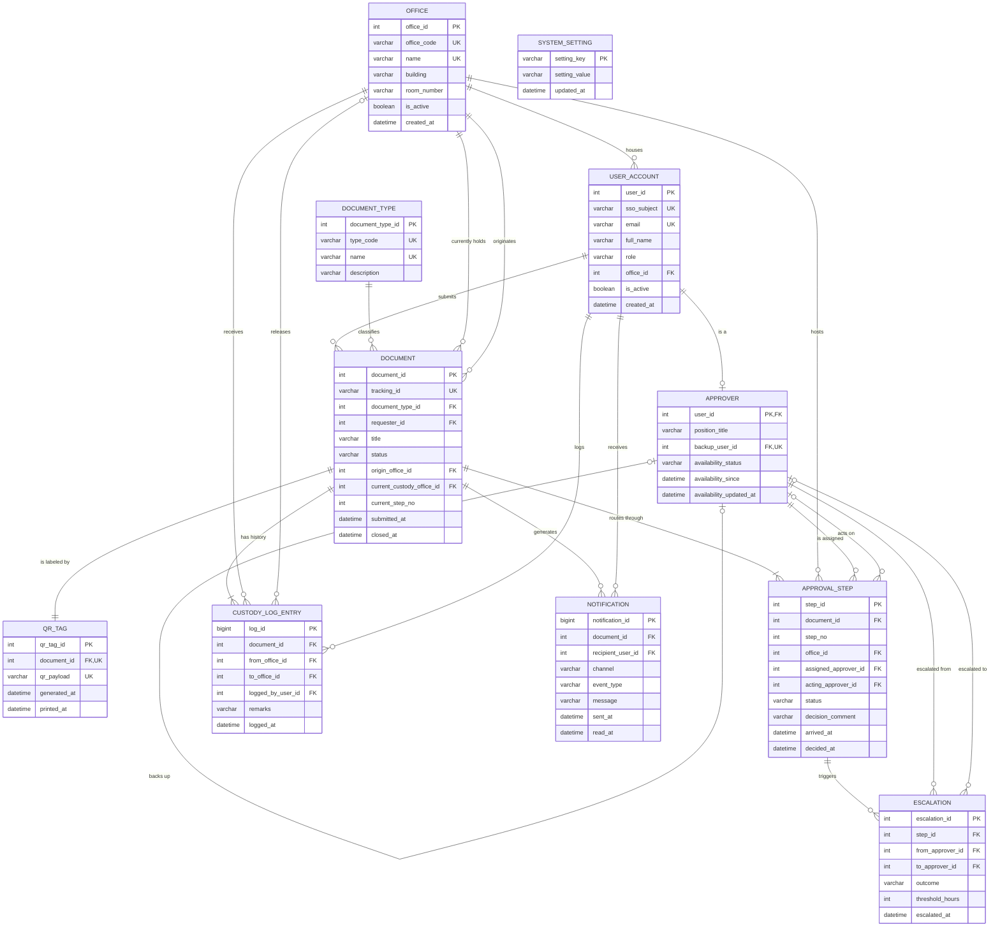

# Activity No. 2 — Data Modeling: Translating UML to Relational Database Schemas

**Course:** CPE 304 – Software Design (Laboratory)
**System:** Smart Campus Logistics System (SCLS) — Document Custody & Approval Tracker
**Group:** Group 2-1
**Instructor:** Engr. William C. Dionisio

| Name | Score | Course/Year/Section | Date |
| --- | --- | --- | --- |
| ______________________ | ____ / 100 | ______________ | ______________ |
| ______________________ | | | |
| ______________________ | | | |
| ______________________ | | | |

---

## I. Input Baseline (Quiz No. 1 UML Class Diagram)

The baseline is the SCLS class diagram in `docs/03-srs/srs-campus-logistics.md` §4.8:

| UML Class | Attributes | Methods | Associations |
| --- | --- | --- | --- |
| `Document` | trackingId, type, status, currentCustodyOfficeId, currentApproverId | advanceToNextOffice(), approve(), reject(), escalate() | 1 → * CustodyLogEntry |
| `CustodyLogEntry` | logId, trackingId, officeId, timestamp | append() | * → 1 Office |
| `Approver` | approverId, name, officeId, availabilityStatus, backupApproverId | setAvailability(), actOnDocument() | 1 → * Document; 0..1 → 0..1 Approver (backs up) |
| `Office` | officeId, name, location | logHandoff() | 1 → * CustodyLogEntry |

### Translation Summary (what changed and why)

Tables hold structural state, not behavior [Slide 2]. Every method was removed and replaced by a foreign key, a constraint, or a record table. The upgrade adds the entities the SRS needs but the four-class baseline left implicit:

| # | Change | Reason |
| --- | --- | --- |
| 1 | `Approver.name` moved to a new `user_account` table; `approver` becomes a **1:1 specialization** of it (shared PK). | Requesters, approvers and office admins are all SSO users (SRS 2.4). Keeping `name`/`email` in one place avoids storing them twice. |
| 2 | `Document.type` (free text) → `document_type` lookup table. | Removes repeated text values and blocks misspelled types. |
| 3 | `Document.currentApproverId` → new **`approval_step`** table (document × approver × office, ordered by `step_no`). | A document passes through *several* approvers, so Document–Approver is really **M:N**. The associative table also records who actually acted (primary or backup), which `actOnDocument()` used to hide. |
| 4 | `escalate()` → **`escalation`** table. | SRS 3.2.5 needs an auditable record of every reassignment or "Blocked — No Backup" event. |
| 5 | New **`qr_tag`** table, **1:1** with `document`. | Each physical document carries exactly one tracking QR code [Slide 7]; SRS Appendix A.2 handoff scanning. |
| 6 | New **`notification`** table. | SRS 3.9: requester and custodian are notified on every status change. |
| 7 | New **`system_setting`** table. | SRS 3.5.5: the 24-hour escalation threshold must be configurable, not hard-coded. |
| 8 | `CustodyLogEntry.trackingId` → `document_id` (surrogate INT FK); `tracking_id` kept as a `UNIQUE` business key on `document`. | Integer keys are cheaper to join and index; the public tracking ID can change format without breaking FKs. |
| 9 | `CustodyLogEntry` gains `from_office_id` and `logged_by_user_id`. | Each row records a full handoff (from → to) and who logged it, for accountability. |
| 10 | `Office.location` split into `building` + `room_number`; added `office_code`. | Atomic columns (1NF); short unique code for QR/handoff screens. |

**Deliberate denormalization:** `document.current_custody_office_id` can be derived from the latest `custody_log_entry`. It is kept because SRS 4.2 calls for it: the dashboard must show custody within 5 s (SRS 3.5.1) without scanning history. The handoff transaction updates it in the same commit that inserts the log row.

---

## II. Task 1 — Data Dictionary Matrix [Slide 3]

Conventions: `snake_case`, singular table names, surrogate `INT` primary keys named `<table>_id`, `DATETIME` timestamps stored in campus local time (Asia/Manila). "UML Source" traces each column back to the Quiz 1 class diagram (**New** = added in this upgrade).

### 1. `office` — a campus office that holds documents (UML `Office`)

| Attribute | Description | Data Type | Format / Allowed Values | Null | Default | UML Source |
| --- | --- | --- | --- | --- | --- | --- |
| office_id | Surrogate identifier | INT | Auto-generated | No | AUTO_INCREMENT | Office.officeId |
| office_code | Short code shown on QR/handoff screens | VARCHAR(10) | e.g. `REG`, `CPE` | No | — | New |
| name | Official office name | VARCHAR(100) | e.g. `Office of the Registrar` | No | — | Office.name |
| building | Building where the office is located | VARCHAR(60) | e.g. `Admin Building` | No | — | Office.location |
| room_number | Room inside the building | VARCHAR(10) | e.g. `R-204` | Yes | NULL | Office.location |
| is_active | Office can receive handoffs | BOOLEAN | TRUE / FALSE | No | TRUE | New |
| created_at | When the office was registered | DATETIME | `YYYY-MM-DD HH:MM:SS` | No | CURRENT_TIMESTAMP | New |

### 2. `user_account` — any SSO-authenticated person (New, carries Approver.name)

| Attribute | Description | Data Type | Format / Allowed Values | Null | Default | UML Source |
| --- | --- | --- | --- | --- | --- | --- |
| user_id | Surrogate identifier | INT | Auto-generated | No | AUTO_INCREMENT | New |
| sso_subject | Immutable ID issued by university SSO | VARCHAR(128) | Opaque SSO string | No | — | New |
| email | University email for notifications | VARCHAR(120) | Must contain `@` and `.` | No | — | New |
| full_name | Display name | VARCHAR(100) | — | No | — | Approver.name |
| role | Primary system role | VARCHAR(15) | `REQUESTER`, `APPROVER`, `OFFICE_ADMIN`, `SYSTEM_ADMIN` | No | `REQUESTER` | New |
| office_id | Home office (none for students) | INT | FK → office | Yes | NULL | Approver.officeId |
| is_active | Account can sign in | BOOLEAN | TRUE / FALSE | No | TRUE | New |
| created_at | First SSO login | DATETIME | `YYYY-MM-DD HH:MM:SS` | No | CURRENT_TIMESTAMP | New |

### 3. `approver` — a user authorized to sign documents (UML `Approver`)

| Attribute | Description | Data Type | Format / Allowed Values | Null | Default | UML Source |
| --- | --- | --- | --- | --- | --- | --- |
| user_id | Same value as the user's `user_account.user_id` | INT | FK → user_account | No | — | Approver.approverId |
| position_title | Signing capacity | VARCHAR(80) | e.g. `Department Head` | No | — | New |
| backup_user_id | Designated backup signer | INT | FK → approver; ≠ own `user_id` | Yes | NULL | Approver.backupApproverId |
| availability_status | Current availability | VARCHAR(15) | `ON_CAMPUS`, `OFF_CAMPUS`, `AWAY`, `BACKUP_ACTIVE`, `UNKNOWN` | No | `UNKNOWN` | Approver.availabilityStatus |
| availability_since | When the current status began (drives the 24 h rule) | DATETIME | ≤ availability_updated_at | No | CURRENT_TIMESTAMP | New (from setAvailability()) |
| availability_updated_at | Last time status was confirmed (stale → shown as Unknown) | DATETIME | `YYYY-MM-DD HH:MM:SS` | No | CURRENT_TIMESTAMP | New (from setAvailability()) |

### 4. `document_type` — category of routed document (New, from Document.type)

| Attribute | Description | Data Type | Format / Allowed Values | Null | Default | UML Source |
| --- | --- | --- | --- | --- | --- | --- |
| document_type_id | Surrogate identifier | INT | Auto-generated | No | AUTO_INCREMENT | New |
| type_code | Short code | VARCHAR(10) | e.g. `LOA`, `PR`, `TRF` | No | — | Document.type |
| name | Readable type name | VARCHAR(80) | e.g. `Leave of Absence` | No | — | Document.type |
| description | Notes on the type | VARCHAR(255) | Free text | Yes | NULL | New |

### 5. `document` — a physical routed document (UML `Document`)

| Attribute | Description | Data Type | Format / Allowed Values | Null | Default | UML Source |
| --- | --- | --- | --- | --- | --- | --- |
| document_id | Surrogate identifier | INT | Auto-generated | No | AUTO_INCREMENT | New |
| tracking_id | Public tracking number given to the requester | VARCHAR(20) | `SCLS-YYYY-NNNNNN` | No | — | Document.trackingId |
| document_type_id | Kind of document | INT | FK → document_type | No | — | Document.type |
| requester_id | Who submitted it | INT | FK → user_account | No | — | New (SRS 3.4.1 requesterId) |
| title | Short subject line | VARCHAR(150) | — | No | — | New |
| status | Lifecycle state | VARCHAR(15) | `SUBMITTED`, `IN_TRANSIT`, `UNDER_REVIEW`, `APPROVED`, `REJECTED`, `BLOCKED` | No | `SUBMITTED` | Document.status |
| origin_office_id | Office where routing started | INT | FK → office | No | — | New |
| current_custody_office_id | Office physically holding it now | INT | FK → office | No | — | Document.currentCustodyOfficeId |
| current_step_no | Approval step the document is on | INT | ≥ 1 | No | 1 | Document.currentApproverId |
| submitted_at | Submission time | DATETIME | `YYYY-MM-DD HH:MM:SS` | No | CURRENT_TIMESTAMP | New |
| closed_at | Final approval/rejection time | DATETIME | Required only when APPROVED/REJECTED | Yes | NULL | New |

### 6. `qr_tag` — QR label attached to a document (New)

| Attribute | Description | Data Type | Format / Allowed Values | Null | Default | UML Source |
| --- | --- | --- | --- | --- | --- | --- |
| qr_tag_id | Surrogate identifier | INT | Auto-generated | No | AUTO_INCREMENT | New |
| document_id | The one document this tag labels | INT | FK → document, UNIQUE | No | — | New |
| qr_payload | Encoded scan URL / token | VARCHAR(255) | e.g. `https://scls.bulsu.edu.ph/t/SCLS-2026-000001` | No | — | New |
| generated_at | When the code was generated | DATETIME | `YYYY-MM-DD HH:MM:SS` | No | CURRENT_TIMESTAMP | New |
| printed_at | When the label was printed | DATETIME | ≥ generated_at | Yes | NULL | New |

### 7. `approval_step` — one signer in a document's approval chain (New, from Document–Approver)

| Attribute | Description | Data Type | Format / Allowed Values | Null | Default | UML Source |
| --- | --- | --- | --- | --- | --- | --- |
| step_id | Surrogate identifier | INT | Auto-generated | No | AUTO_INCREMENT | New |
| document_id | Document being approved | INT | FK → document | No | — | Approver "acts on" Document |
| step_no | Order in the chain | INT | ≥ 1, unique per document | No | — | advanceToNextOffice() |
| office_id | Office where this step happens | INT | FK → office | No | — | New |
| assigned_approver_id | Primary signer for this step | INT | FK → approver | No | — | Document.currentApproverId |
| acting_approver_id | Who actually decided (primary or backup) | INT | FK → approver; required once decided | Yes | NULL | actOnDocument() |
| status | Step state | VARCHAR(10) | `WAITING`, `PENDING`, `APPROVED`, `REJECTED`, `SKIPPED` | No | `WAITING` | approve() / reject() |
| decision_comment | Optional approver remark | VARCHAR(500) | Free text | Yes | NULL | New (SRS 3.2.4) |
| arrived_at | When the document reached this desk | DATETIME | `YYYY-MM-DD HH:MM:SS` | Yes | NULL | New |
| decided_at | When the decision was made | DATETIME | ≥ arrived_at | Yes | NULL | New |

### 8. `custody_log_entry` — immutable handoff record (UML `CustodyLogEntry`)

| Attribute | Description | Data Type | Format / Allowed Values | Null | Default | UML Source |
| --- | --- | --- | --- | --- | --- | --- |
| log_id | Surrogate identifier (high volume) | BIGINT | Auto-generated | No | AUTO_INCREMENT | CustodyLogEntry.logId |
| document_id | Document handed off | INT | FK → document | No | — | CustodyLogEntry.trackingId |
| from_office_id | Previous holder (NULL on first intake) | INT | FK → office; ≠ to_office_id | Yes | NULL | New |
| to_office_id | New holder | INT | FK → office | No | — | CustodyLogEntry.officeId |
| logged_by_user_id | Office admin who confirmed the handoff | INT | FK → user_account | No | — | New (from logHandoff()) |
| remarks | Optional handoff note | VARCHAR(255) | Free text | Yes | NULL | New |
| logged_at | Handoff time | DATETIME | `YYYY-MM-DD HH:MM:SS` | No | CURRENT_TIMESTAMP | CustodyLogEntry.timestamp |

### 9. `escalation` — automatic reassignment event (New, from Document.escalate())

| Attribute | Description | Data Type | Format / Allowed Values | Null | Default | UML Source |
| --- | --- | --- | --- | --- | --- | --- |
| escalation_id | Surrogate identifier | INT | Auto-generated | No | AUTO_INCREMENT | New |
| step_id | Approval step that stalled | INT | FK → approval_step | No | — | escalate() |
| from_approver_id | Unavailable primary approver | INT | FK → approver | No | — | escalate() |
| to_approver_id | Backup who received the task | INT | FK → approver; NULL only if blocked | Yes | NULL | Approver.backupApproverId |
| outcome | Result of the escalation | VARCHAR(20) | `REASSIGNED`, `BLOCKED_NO_BACKUP` | No | — | escalate() |
| threshold_hours | Threshold in force when it fired | INT | > 0 | No | — | New (SRS 3.5.5) |
| escalated_at | When it happened | DATETIME | `YYYY-MM-DD HH:MM:SS` | No | CURRENT_TIMESTAMP | New |

### 10. `notification` — message sent about a document (New)

| Attribute | Description | Data Type | Format / Allowed Values | Null | Default | UML Source |
| --- | --- | --- | --- | --- | --- | --- |
| notification_id | Surrogate identifier | BIGINT | Auto-generated | No | AUTO_INCREMENT | New |
| document_id | Document the message is about | INT | FK → document | No | — | New |
| recipient_user_id | Who receives it | INT | FK → user_account | No | — | New |
| channel | Delivery channel | VARCHAR(10) | `EMAIL`, `DASHBOARD` | No | — | New |
| event_type | Trigger | VARCHAR(20) | `SUBMITTED`, `HANDOFF`, `APPROVED`, `REJECTED`, `ESCALATED`, `BLOCKED` | No | — | New |
| message | Body text | VARCHAR(500) | — | No | — | New |
| sent_at | Send time | DATETIME | `YYYY-MM-DD HH:MM:SS` | No | CURRENT_TIMESTAMP | New |
| read_at | When opened (dashboard) | DATETIME | ≥ sent_at | Yes | NULL | New |

### 11. `system_setting` — configurable business rules (New)

| Attribute | Description | Data Type | Format / Allowed Values | Null | Default | UML Source |
| --- | --- | --- | --- | --- | --- | --- |
| setting_key | Rule name | VARCHAR(50) | e.g. `escalation_threshold_hours` | No | — | New |
| setting_value | Rule value | VARCHAR(100) | e.g. `24` | No | — | New |
| updated_at | Last change | DATETIME | `YYYY-MM-DD HH:MM:SS` | No | CURRENT_TIMESTAMP | New |

---

## III. Task 2 — Logical Entity-Relationship Diagram [Slide 7, Slide 8]

Crow's-foot notation: `||` exactly one, `o|` zero or one, `|{` one or more, `o{` zero or more. A rendered copy for printing is in [`scls_erd.png`](./scls_erd.png).

### Cardinality Matrix (UML multiplicity → database cardinality)

| # | Parent (1 side) | Child (N side) | UML Multiplicity | DB Cardinality | Implemented By | Real-World Rule |
| --- | --- | --- | --- | --- | --- | --- |
| R1 | office | user_account | 0..1 — 0..* | 1:N (optional) | `user_account.office_id` FK, nullable | One office houses many staff; students belong to no office. |
| R2 | user_account | approver | 1 — 0..1 | **1:1** (optional) | `approver.user_id` is both PK and FK | A user is an approver at most once; every approver is exactly one user. |
| R3 | approver | approver | 0..1 — 0..1 | **1:1** recursive | `approver.backup_user_id` FK + UNIQUE | An approver has at most one backup, and a backup covers at most one approver. |
| R4 | user_account | document | 1 — 0..* | 1:N | `document.requester_id` FK, NOT NULL | One requester submits many documents; each document has exactly one requester. |
| R5 | document_type | document | 1 — 0..* | 1:N | `document.document_type_id` FK | Every document has one type. |
| R6 | office | document (custody) | 1 — 0..* | 1:N | `document.current_custody_office_id` FK | A document is in exactly one office at a time. |
| R7 | office | document (origin) | 1 — 0..* | 1:N | `document.origin_office_id` FK | A document starts in exactly one office. |
| R8 | document | qr_tag | 1 — 1 | **1:1** | `qr_tag.document_id` FK + UNIQUE + NOT NULL | Each physical document has exactly one tracking QR code [Slide 7]. |
| R9 | document | approval_step | 1 — 1..* | 1:N (mandatory) | `approval_step.document_id` FK + UNIQUE(document_id, step_no) | Every document has an approval chain of at least one step. |
| R10 | approver | approval_step (assigned) | 1 — 0..* | 1:N | `approval_step.assigned_approver_id` FK | Each step has exactly one primary signer. |
| R11 | approver | approval_step (acting) | 0..1 — 0..* | 1:N (optional) | `approval_step.acting_approver_id` FK, nullable | Empty until someone (primary or backup) decides. |
| R12 | office | approval_step | 1 — 0..* | 1:N | `approval_step.office_id` FK | Each step takes place in one office. |
| — | document ↔ approver | — | * — * | **M:N** resolved | `approval_step` (associative entity) | A document needs several signers; a signer handles many documents. |
| R13 | document | custody_log_entry | 1 — 1..* | 1:N (mandatory) | `custody_log_entry.document_id` FK | Intake creates the first entry; each handoff adds one. |
| R14 | office | custody_log_entry (to / from) | 1 — 0..* / 0..1 — 0..* | 1:N (×2) | `to_office_id` NOT NULL, `from_office_id` nullable | Each entry is one move from an office to another office. |
| R15 | user_account | custody_log_entry | 1 — 0..* | 1:N | `custody_log_entry.logged_by_user_id` FK | Every handoff names the admin who logged it. |
| R16 | approval_step | escalation | 1 — 0..* | 1:N | `escalation.step_id` FK | A stalled step can escalate (repeatedly, if the backup is also away). |
| R17 | approver | escalation (from / to) | 1 — 0..* / 0..1 — 0..* | 1:N (×2) | `from_approver_id` NOT NULL, `to_approver_id` nullable | NULL target means "Blocked — No Backup Available" (SRS 3.2.5.5). |
| R18 | document | notification | 1 — 0..* | 1:N | `notification.document_id` FK | Each status change produces notifications. |
| R19 | user_account | notification | 1 — 0..* | 1:N | `notification.recipient_user_id` FK | A user receives many notifications. |

---

## IV. Task 3 — Physical Schema Translation Table [Slide 10]

Target DBMS: MySQL 8.0 (InnoDB). Every FK uses the default `RESTRICT` action, so a referenced parent row cannot be deleted and an orphan child row cannot be inserted [Slide 9]. The runnable DDL is in [`scls_schema.sql`](./scls_schema.sql).

| Entity Name | Attribute Name | Data Type | Key Type | Constraint / Rationale |
| --- | --- | --- | --- | --- |
| **office** | office_id | INT | PK | AUTO_INCREMENT [Slide 10] |
| **office** | office_code | VARCHAR(10) | UK | NOT NULL, UNIQUE — no two offices share a code [Slide 10] |
| **office** | name | VARCHAR(100) | UK | NOT NULL, UNIQUE [Slide 10] |
| **office** | building | VARCHAR(60) | – | NOT NULL |
| **office** | room_number | VARCHAR(10) | – | NULL allowed |
| **office** | is_active | BOOLEAN | – | NOT NULL DEFAULT TRUE — offices are retired, never deleted, because history references them |
| **office** | created_at | DATETIME | – | NOT NULL DEFAULT CURRENT_TIMESTAMP |
| **user_account** | user_id | INT | PK | AUTO_INCREMENT [Slide 10] |
| **user_account** | sso_subject | VARCHAR(128) | UK | NOT NULL, UNIQUE — one row per SSO identity (SRS 2.4) |
| **user_account** | email | VARCHAR(120) | UK | NOT NULL, UNIQUE, CHECK (`email LIKE '%_@_%._%'`) |
| **user_account** | full_name | VARCHAR(100) | – | NOT NULL |
| **user_account** | role | VARCHAR(15) | – | NOT NULL DEFAULT 'REQUESTER', CHECK IN ('REQUESTER','APPROVER','OFFICE_ADMIN','SYSTEM_ADMIN') [Slide 9] |
| **user_account** | office_id | INT | FK | References office(office_id); NULL allowed (students) [Slide 6] |
| **user_account** | is_active | BOOLEAN | – | NOT NULL DEFAULT TRUE — deactivate instead of delete |
| **user_account** | created_at | DATETIME | – | NOT NULL DEFAULT CURRENT_TIMESTAMP |
| **approver** | user_id | INT | PK, FK | References user_account(user_id) — shared PK makes the relationship 1:1 [Slide 7] |
| **approver** | position_title | VARCHAR(80) | – | NOT NULL |
| **approver** | backup_user_id | INT | FK, UK | References approver(user_id); UNIQUE (one backup covers one approver); CHECK (`backup_user_id <> user_id`) — nobody backs up themselves |
| **approver** | availability_status | VARCHAR(15) | – | NOT NULL DEFAULT 'UNKNOWN', CHECK IN ('ON_CAMPUS','OFF_CAMPUS','AWAY','BACKUP_ACTIVE','UNKNOWN') — replaces `setAvailability()`; SRS 3.2.3.5 defaults to Unknown |
| **approver** | availability_since | DATETIME | – | NOT NULL — start of the current status; the escalation job compares it to the 24 h threshold |
| **approver** | availability_updated_at | DATETIME | – | NOT NULL, CHECK (`availability_updated_at >= availability_since`) |
| **document_type** | document_type_id | INT | PK | AUTO_INCREMENT [Slide 10] |
| **document_type** | type_code | VARCHAR(10) | UK | NOT NULL, UNIQUE |
| **document_type** | name | VARCHAR(80) | UK | NOT NULL, UNIQUE |
| **document_type** | description | VARCHAR(255) | – | NULL allowed |
| **document** | document_id | INT | PK | AUTO_INCREMENT [Slide 10] |
| **document** | tracking_id | VARCHAR(20) | UK | NOT NULL, UNIQUE, CHECK (`tracking_id LIKE 'SCLS-%'`) — public ID, never reused |
| **document** | document_type_id | INT | FK | NOT NULL, references document_type(document_type_id) |
| **document** | requester_id | INT | FK | NOT NULL, references user_account(user_id) — every document has an owner [Slide 4, Slide 6] |
| **document** | title | VARCHAR(150) | – | NOT NULL |
| **document** | status | VARCHAR(15) | – | NOT NULL DEFAULT 'SUBMITTED', CHECK IN ('SUBMITTED','IN_TRANSIT','UNDER_REVIEW','APPROVED','REJECTED','BLOCKED') |
| **document** | origin_office_id | INT | FK | NOT NULL, references office(office_id) |
| **document** | current_custody_office_id | INT | FK | NOT NULL, references office(office_id) — dashboard cache, updated in the handoff transaction (SRS 4.2) |
| **document** | current_step_no | INT | – | NOT NULL DEFAULT 1, CHECK (`>= 1`) — replaces `advanceToNextOffice()` |
| **document** | submitted_at | DATETIME | – | NOT NULL DEFAULT CURRENT_TIMESTAMP |
| **document** | closed_at | DATETIME | – | CHECK: required and ≥ submitted_at when status is APPROVED/REJECTED, otherwise NULL |
| **qr_tag** | qr_tag_id | INT | PK | AUTO_INCREMENT [Slide 10] |
| **qr_tag** | document_id | INT | FK, UK | NOT NULL, UNIQUE, references document(document_id) — enforces exactly one QR per document (1:1) [Slide 7] |
| **qr_tag** | qr_payload | VARCHAR(255) | UK | NOT NULL, UNIQUE — no two documents scan to the same code |
| **qr_tag** | generated_at | DATETIME | – | NOT NULL DEFAULT CURRENT_TIMESTAMP |
| **qr_tag** | printed_at | DATETIME | – | CHECK (`printed_at IS NULL OR printed_at >= generated_at`) |
| **approval_step** | step_id | INT | PK | AUTO_INCREMENT [Slide 10] |
| **approval_step** | document_id | INT | FK | NOT NULL, references document(document_id) |
| **approval_step** | step_no | INT | UK (composite) | NOT NULL, CHECK (`>= 1`), UNIQUE (document_id, step_no) — no duplicate or ambiguous chain positions |
| **approval_step** | office_id | INT | FK | NOT NULL, references office(office_id) |
| **approval_step** | assigned_approver_id | INT | FK | NOT NULL, references approver(user_id) — SRS 3.2.1.5 rejects chains naming unknown approvers |
| **approval_step** | acting_approver_id | INT | FK | References approver(user_id); required once decided — replaces `actOnDocument()` |
| **approval_step** | status | VARCHAR(10) | – | NOT NULL DEFAULT 'WAITING', CHECK IN ('WAITING','PENDING','APPROVED','REJECTED','SKIPPED') — replaces `approve()` / `reject()` |
| **approval_step** | decision_comment | VARCHAR(500) | – | NULL allowed |
| **approval_step** | arrived_at | DATETIME | – | NULL until the document reaches the desk |
| **approval_step** | decided_at | DATETIME | – | CHECK: a decided step must have acting_approver_id, arrived_at and decided_at ≥ arrived_at; an undecided step has decided_at NULL |
| **custody_log_entry** | log_id | BIGINT | PK | AUTO_INCREMENT — BIGINT because the table only grows and is kept forever (SRS 3.8) |
| **custody_log_entry** | document_id | INT | FK | NOT NULL, references document(document_id) |
| **custody_log_entry** | from_office_id | INT | FK | References office(office_id); NULL only on first intake; CHECK (`from_office_id <> to_office_id`) |
| **custody_log_entry** | to_office_id | INT | FK | NOT NULL, references office(office_id) |
| **custody_log_entry** | logged_by_user_id | INT | FK | NOT NULL, references user_account(user_id) — accountability |
| **custody_log_entry** | remarks | VARCHAR(255) | – | NULL allowed |
| **custody_log_entry** | logged_at | DATETIME | – | NOT NULL DEFAULT CURRENT_TIMESTAMP |
| **custody_log_entry** | *(table rule)* | – | – | Triggers `trg_custody_log_no_update` / `trg_custody_log_no_delete` reject UPDATE and DELETE — append-only (SRS 3.5.2); replaces `append()` |
| **escalation** | escalation_id | INT | PK | AUTO_INCREMENT [Slide 10] |
| **escalation** | step_id | INT | FK | NOT NULL, references approval_step(step_id) |
| **escalation** | from_approver_id | INT | FK | NOT NULL, references approver(user_id) |
| **escalation** | to_approver_id | INT | FK | References approver(user_id) |
| **escalation** | outcome | VARCHAR(20) | – | NOT NULL, CHECK: 'REASSIGNED' requires a target ≠ from_approver_id; 'BLOCKED_NO_BACKUP' requires a NULL target — replaces `escalate()` |
| **escalation** | threshold_hours | INT | – | NOT NULL, CHECK (`> 0`) — snapshot of the rule in force |
| **escalation** | escalated_at | DATETIME | – | NOT NULL DEFAULT CURRENT_TIMESTAMP |
| **notification** | notification_id | BIGINT | PK | AUTO_INCREMENT [Slide 10] |
| **notification** | document_id | INT | FK | NOT NULL, references document(document_id) |
| **notification** | recipient_user_id | INT | FK | NOT NULL, references user_account(user_id) |
| **notification** | channel | VARCHAR(10) | – | NOT NULL, CHECK IN ('EMAIL','DASHBOARD') |
| **notification** | event_type | VARCHAR(20) | – | NOT NULL, CHECK IN ('SUBMITTED','HANDOFF','APPROVED','REJECTED','ESCALATED','BLOCKED') |
| **notification** | message | VARCHAR(500) | – | NOT NULL |
| **notification** | sent_at | DATETIME | – | NOT NULL DEFAULT CURRENT_TIMESTAMP |
| **notification** | read_at | DATETIME | – | CHECK (`read_at IS NULL OR read_at >= sent_at`) |
| **system_setting** | setting_key | VARCHAR(50) | PK | Natural key, e.g. `escalation_threshold_hours` = `24` (SRS 3.5.5) |
| **system_setting** | setting_value | VARCHAR(100) | – | NOT NULL |
| **system_setting** | updated_at | DATETIME | – | NOT NULL DEFAULT CURRENT_TIMESTAMP |

---

## V. Behavior-to-Constraint Mapping [Slide 9]

Each UML method is replaced by a structural rule that the database enforces, independent of application code.

| UML Method (Quiz 1) | Database Replacement | What the DB Rejects |
| --- | --- | --- |
| `Document.advanceToNextOffice()` | `approval_step` rows with UNIQUE (document_id, step_no); `document.current_step_no` CHECK ≥ 1 | Two steps at the same position; a step referencing a non-existent office or approver |
| `Document.approve()` / `reject()` | `approval_step.status` CHECK list + `ck_step_decided`; `document.status` CHECK + `ck_document_closed` | A decision with no acting approver or timestamp; a closed document with no `closed_at`; unknown status values |
| `Document.escalate()` | `escalation` table + `ck_escalation_outcome`; `system_setting.escalation_threshold_hours` | A reassignment with no backup, a reassignment back to the same approver, or a "blocked" record that names a target |
| `CustodyLogEntry.append()` | No-UPDATE/no-DELETE triggers; FKs to document/office/user | Editing or deleting history; a handoff to an unknown office; a handoff from an office to itself |
| `Approver.setAvailability()` | `availability_status` CHECK list; `availability_since` / `availability_updated_at` | Invented status values; timestamps out of order |
| `Approver.actOnDocument()` | `approval_step.acting_approver_id` FK → approver | A decision recorded by someone who is not a registered approver |
| `Office.logHandoff()` | `custody_log_entry.logged_by_user_id` NOT NULL FK | Anonymous handoffs |
| Backup designation | `approver.backup_user_id` FK + UNIQUE + CHECK ≠ self | Self-backup; one backup covering several approvers; a backup who is not an approver |

**Left to the application layer** (needs data from other rows or other systems, so it can't be a column-level constraint):

- "Only the assigned approver *or their active backup* may decide" (SRS 3.5.4): checked in the API against `approval_step.assigned_approver_id` and `approver.backup_user_id` before the UPDATE.
- "The chain cannot be altered once routing has begun" (SRS 3.6): the API refuses changes to `approval_step` rows once any step is past `WAITING`, except through a logged admin override.
- Handoff must go to the *next* office in the chain (SRS 3.2.2.5): the API compares `to_office_id` with the office of step `current_step_no`.

---

## VI. Verification

`scls_schema.sql` was executed against an in-memory SQLite database (MySQL `AUTO_INCREMENT` and trigger syntax translated to SQLite equivalents). A sample routing scenario (three offices, two approvers with a backup, one document with a QR tag, a two-step chain, two handoffs, one escalation, one notification) loaded with no errors. The following invalid operations were all rejected:

| Test | Rejected By |
| --- | --- |
| Duplicate office code | UNIQUE `office.office_code` |
| Unknown user role | `ck_user_role` |
| Approver row with no matching user | FK `fk_approver_user` |
| Approver set as their own backup | `ck_approver_not_own_backup` |
| Document with non-existent requester | FK `fk_document_requester` |
| Tracking ID without `SCLS-` prefix | `ck_document_tracking` |
| Document marked APPROVED with no `closed_at` | `ck_document_closed` |
| Second QR tag for the same document | UNIQUE `qr_tag.document_id` |
| Duplicate step number in a chain | UNIQUE (document_id, step_no) |
| Step REJECTED with no acting approver | `ck_step_decided` |
| Handoff from an office to itself | `ck_custody_move` |
| UPDATE / DELETE on custody log | append-only triggers |
| REASSIGNED escalation with no target | `ck_escalation_outcome` |
| Deleting an office still referenced by history | FK (RESTRICT) |
| Notification on unknown channel | `ck_notification_channel` |
