# Activity No. 5 – UX Evaluation and Refinement (Client-System)

**Bulacan State University** · College of Engineering – Department of Computer Engineering · CPE 304L – Software Design (Laboratory)

| Field | Details |
|---|---|
| Evaluating Group Name | G2 - Group1 |
| Members | Lopez, Cyrus Angelo S. Roque, Francis Benedict S. Santos, John Carlo Santos, Mark Kean G. |
| Date | November 9, 2026 |
| Target/Assigned Group | ____________________ |
| Target Group Members | ____________________ |
| Score | ____ / 100 |

## Intended Learning Outcomes (ILOs)

1. Describe usability testing protocols, heuristic evaluation frameworks, and user feedback collection methods. [CO2]
2. Analyze usability test results to identify navigation friction points, UI flaws, and accessibility issues. [CO2]
3. Refine high-fidelity software prototypes based on empirical user feedback and usability test findings. [CO2]

## Task 1: Evaluation Team & Peer System Overview

In accordance with the 1:1 bilateral laboratory testing protocol, our group conducted a usability evaluation of the Casa de Stella Catering Services client system, the public event-booking website built for Stella's Event Management Services in Malolos, Bulacan. Testing was performed on the live deployed frontend rather than a static prototype, so every flow was exercised end to end against the real backend.

| Item | Details |
|---|---|
| Evaluated Peer Group Name | ____________________ |
| Peer Mini-System Title | Casa de Stella Catering Services – Event Management Website (Client System) |
| Live Frontend Link | https://stella-catering-82j.pages.dev/ |
| Test Date | November 9, 2026 |
| Test Devices / Viewports | Desktop Chromium at 1366 × 850 and 1280 × 800; mobile emulation of an iPhone 13 (390 × 664) |
| Test Accounts | One guest account created during testing (uxtest_g2g1_057667); staff sign-in tested with invalid credentials only |
| Test Data Created | Booking #19 (Grand Emerald Wedding Package, 60 guests, January 8, 2027), labelled "USABILITY TEST BOOKING – please decline/delete" |
| Tester / User Name(s) | Cyrus Angelo S. Lopez & John Carlo Santos |
| Observer / Recorder Name(s) | Mark Kean G. Santos & Francis Benedict S. Roque |

### Task Scenarios Executed

| ID | Scenario | Steps Performed | Result | Related Bugs |
|---|---|---|---|---|
| S1 | Browse and compare catering packages | Home → Packages → filter by Debut, Corporate and Special Event → open package Details → try an invalid package ID | Completed | B-06, B-11 |
| S2 | Create a guest account and submit a booking request | Package Details → Book this package → sign-in wall → Create account → booking form (invalid then valid input) → Submit | Completed with friction (Booking #19 created, status Pending) | B-02, B-03, B-04, B-05 |
| S3 | Monitor the reservation after booking | Track this booking → Dashboard → Your reservations → Track via token → look up an invalid token | Completed with friction | B-01, B-08, B-10 |
| S4 | Recover a forgotten password and attempt staff sign-in | Sign in with a wrong password → Forgot password → request OTP → Staff login with invalid credentials | Completed (errors shown clearly) | B-09 |
| S5 | Repeat S1 on a mobile phone | iPhone 13 emulation → Home → Packages → Register | Completed with friction | B-07 |

### Positive Observations (User Feedback)

- The 7-day lead time is enforced both in the date picker (min date) and on submit, with a clear message.
- Selecting a package automatically raises the guest-count minimum to that package's minPax.
- The chosen package is remembered across the sign-in/registration detour and pre-selected on return.
- The signed-in email is shown read-only on the booking form, which prevents booking under the wrong email.
- Invalid package IDs and tracking tokens return clear, human-readable messages instead of blank screens.
- Password fields have a Show/Hide toggle, and wrong credentials produce a clear "Invalid username or password".

## Task 2: Task-Based Usability Testing & Bug Analysis Log

Usability testing and bug analysis were carried out across five task scenarios using Nielsen's 10 Usability Heuristics. Each defect was rated on a standardized 0–4 severity scale (0 = No Issue, 1 = Cosmetic, 2 = Medium Friction, 3 = Major Usability Flaw, 4 = Blocker).

| Bug # | Scenario / Task Executed | Expected Outcome | Observed Friction / Bug | Heuristic Violated | Severity (0-4) |
|---|---|---|---|---|---|
| B-01 | S3 – Review a reservation from the guest Dashboard. | Each reservation card names the booked package (e.g., "Grand Emerald Wedding Package"). | The card heading shows the generic placeholder "Booking" instead of the package name. A guest with several reservations cannot tell them apart without opening Track for each one. | #6 Recognition rather than recall | 3 (Major) |
| B-02 | S2 – Choose a package and headcount on the booking form. | Before submitting, the guest sees what the event will cost for the chosen package and guest count. | Only the base price is shown ("₱55,000 · min 50"). Raising the guest count to 60 produces no estimate, and no screen says whether the price is flat or charged per head above the minimum. Guests submit a request without knowing the cost. | #2 Match between system and the real world; #1 Visibility of system status | 3 (Major) |
| B-03 | S2 – Follow the Home page "How to book" guide and click "Book a date". | The guide lists every step needed to book, including any account requirement. | The four-step guide skips account creation ("Choose a package → Open Book → Submit → Track"). Clicking "Book a date" or a card's "Book" button leads to a "Sign in to request a date" wall, so guests learn about the requirement only after they have started. | #4 Consistency and standards | 2 (Medium) |
| B-04 | S2 – Submit a valid booking request. | A clear confirmation page appears with the booking number, tracking token and next steps, and the request cannot be sent twice by accident. | The success message appears at the bottom of the long form, under fields that have just been cleared, and the "Submit booking request" button stays active below it. A guest looking at the top of the page sees nothing change, and a second click starts a new request. | #5 Error prevention; #1 Visibility of system status | 2 (Medium) |
| B-05 | S2 – Register and fill in the mobile number and username. | Field-level messages state the rule, for example "Use 11 digits starting with 09, no spaces." | Entering "0917 123 4567" or the username "1juan" only shows the browser tooltip "Please match the requested format." The rule is not written on the label, the tooltip disappears after a moment, and the common spaced phone format is rejected instead of being cleaned up automatically. | #9 Help users recognize, diagnose, and recover from errors | 2 (Medium) |
| B-06 | S1 – Browse the Special Event category. | The public catalog lists only real packages that are ready for clients. | A test package, "Phew Phew" ("Ikaw bahala kung ano gusto. 😆", ₱10,000), appears in the public catalog, under Featured packages on Home, and in the booking form's package dropdown. Guests can book it. | #8 Aesthetic and minimalist design | 2 (Medium) |
| B-07 | S5 – Browse packages on a phone (iPhone 13, 390 × 664). | A compact header (logo + menu button) leaves most of the screen for content. | The navigation wraps into three rows beside the brand name and the tagline wraps onto three lines. The header is about 160 px tall, nearly a quarter of the viewport, and pushes the content down on every page. | #8 Aesthetic and minimalist design; #7 Flexibility and efficiency of use | 2 (Medium) |
| B-08 | S3 – Read the Dashboard counters and prices. | Numbers can be read without ambiguity. | The display font (Cormorant Garamond) uses old-style figures. On the Dashboard counters, "1" looks like a capital "I" and "0" looks like a lowercase "o", and "G2G1" in the account name reads as "G2GI". Prices use the same figures. | #6 Recognition rather than recall (legibility / accessibility) | 2 (Medium) |
| B-09 | S4 – Reset a forgotten password. | The form accepts the email used at registration and orders its actions in the sequence they must happen. | The fields are labelled "Gmail" and "Gmail verification code", although registration accepts any email address. "Email me a code" (the first step) sits at the bottom next to "Update password", after the code and new-password fields, so guests tend to fill everything in before they request the code. | #2 Match between system and the real world; #5 Error prevention | 2 (Medium) |
| B-10 | S3 – Track a reservation with its token. | The status is explained, with what happens next and when. | The tracking result shows only a "PENDING" badge and "Updated <date>". It does not explain what Pending means, how long a review takes, or which statuses come next (Confirmed → Completed). | #10 Help and documentation; #1 Visibility of system status | 1 (Minor) |
| B-11 | S1 / S3 – Move between views with several tabs open or with a screen reader. | Each view has its own browser title and a top-level heading. | The browser tab title is always "Casa de Stella Catering". Inner views use only h2 headings (no h1), and focus is not moved when the route changes, so tabs look identical and screen readers do not announce the new page. | #4 Consistency and standards (accessibility, WCAG 2.4.2 Page Titled) | 1 (Minor) |

### Evidence: Steps to Reproduce & Annotated Screenshots

#### B-01 – Reservation cards on the guest Dashboard show "Booking" instead of the package name.

**Severity:** 3 (Major) · **Heuristic:** #6 Recognition rather than recall

**Steps to reproduce:** Sign in as a guest with at least one booking → Dashboard → "Your reservations" section.

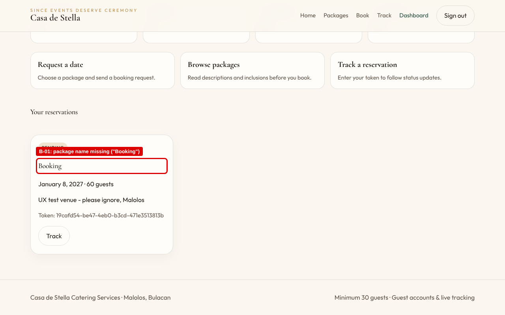

#### B-02 – No cost estimate; pricing basis (flat vs. per head) is unstated.

**Severity:** 3 (Major) · **Heuristic:** #2 Match between system and the real world; #1 Visibility of system status

**Steps to reproduce:** Sign in → Book → select Grand Emerald Wedding Package → change Guest count from 50 to 60 → observe the form.

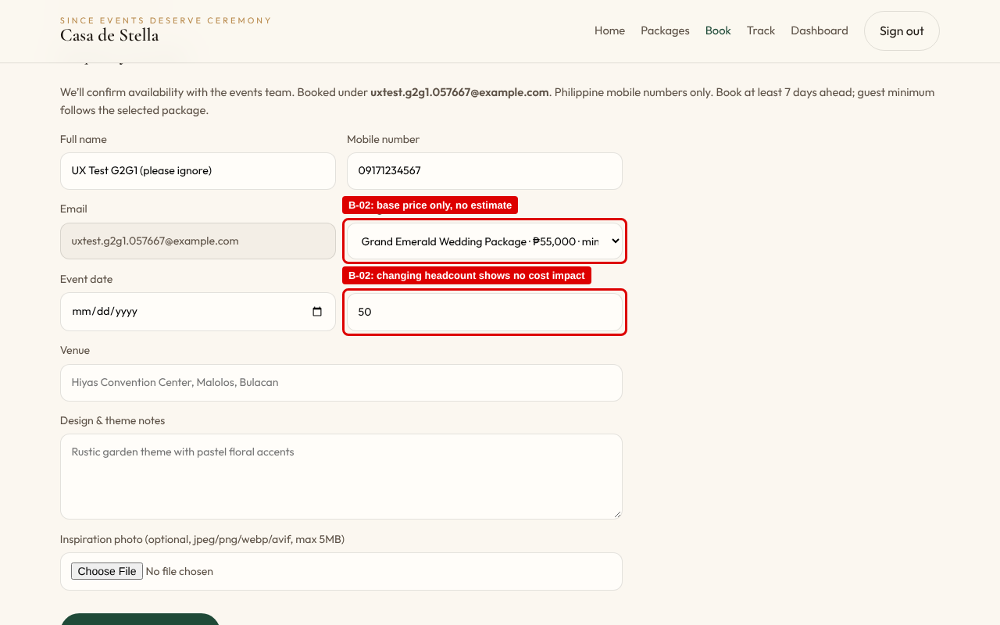

#### B-03 – The "How to book" guide does not match the real flow, which requires an account.

**Severity:** 2 (Medium) · **Heuristic:** #4 Consistency and standards

**Steps to reproduce:** Signed out → Home → read "How to book" → click "Book a date" (or "Book" on any package card).

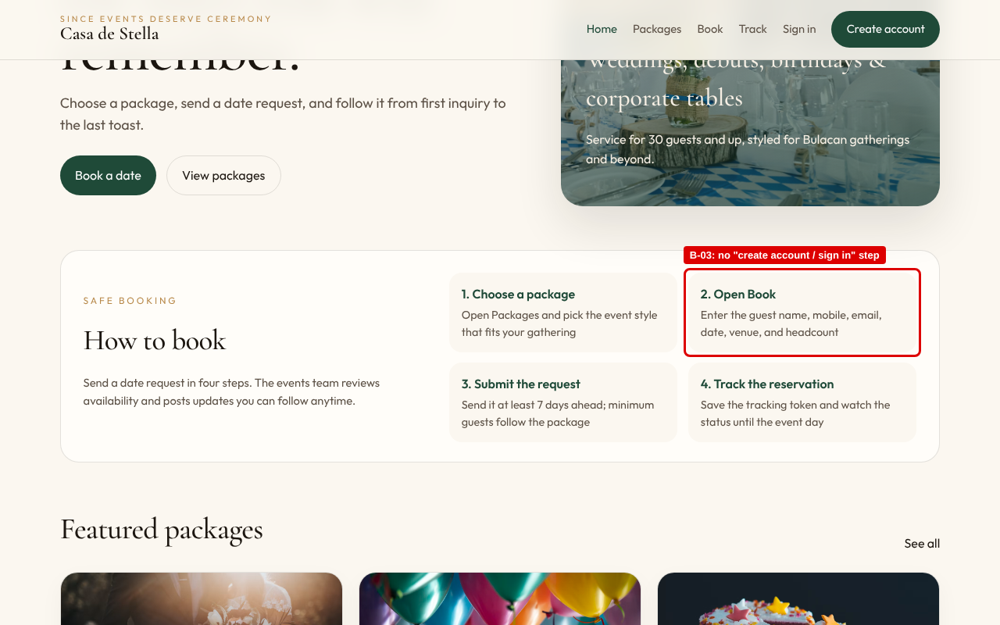

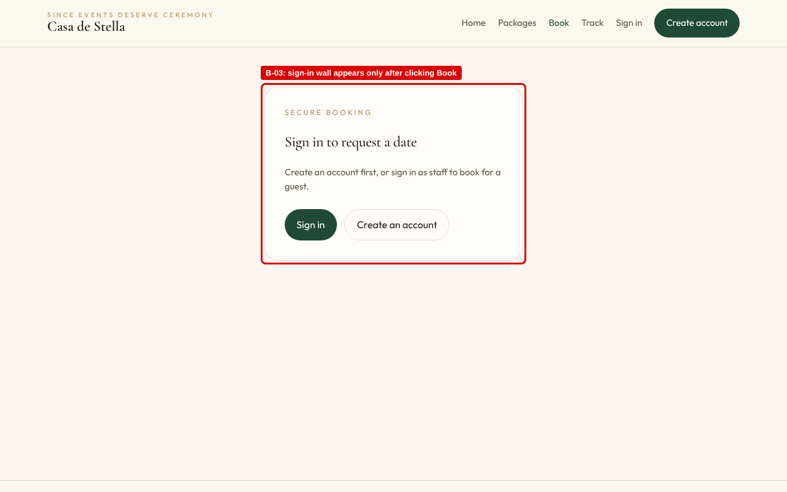

#### B-04 – The confirmation is easy to miss and the form can be resubmitted.

**Severity:** 2 (Medium) · **Heuristic:** #5 Error prevention; #1 Visibility of system status

**Steps to reproduce:** Complete the booking form with valid data → Submit booking request → observe the page without scrolling.

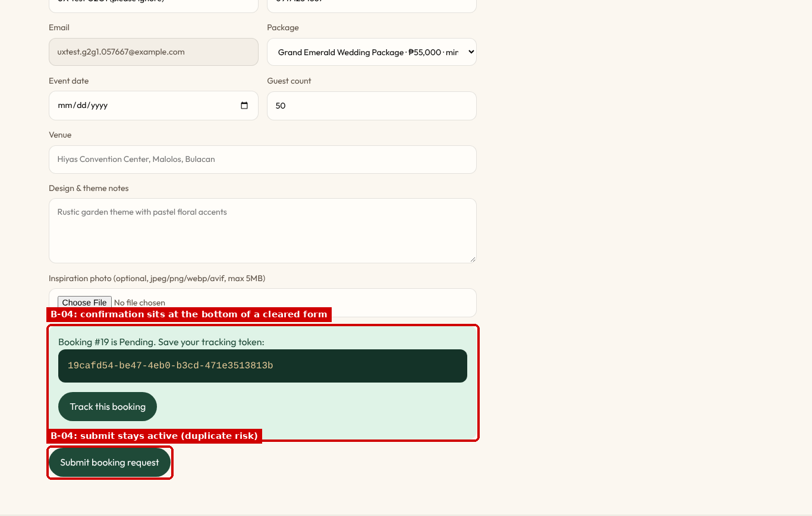

#### B-05 – Generic "Please match the requested format" messages that do not state the rule.

**Severity:** 2 (Medium) · **Heuristic:** #9 Help users recognize, diagnose, and recover from errors

**Steps to reproduce:** Register (or Book) → Mobile number "0917 123 4567" / Username "1juan" → Submit.

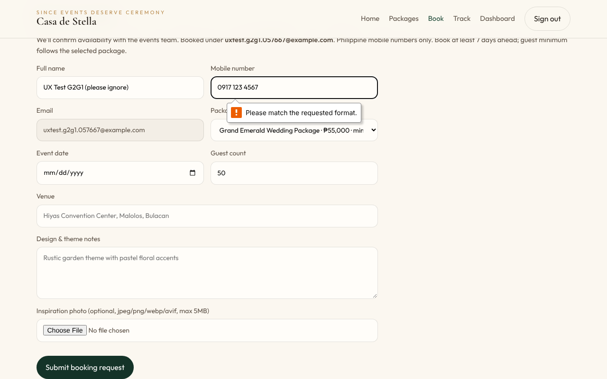

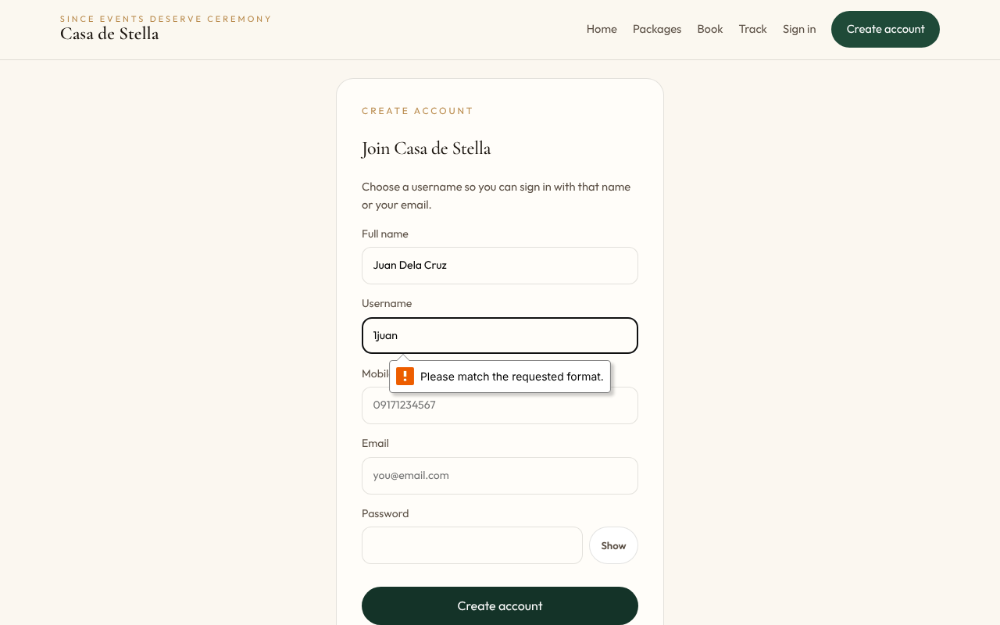

#### B-06 – A placeholder package is visible to and bookable by clients.

**Severity:** 2 (Medium) · **Heuristic:** #8 Aesthetic and minimalist design

**Steps to reproduce:** Packages → Special Event chip (also visible on Home → Featured packages, and Book → Package dropdown).

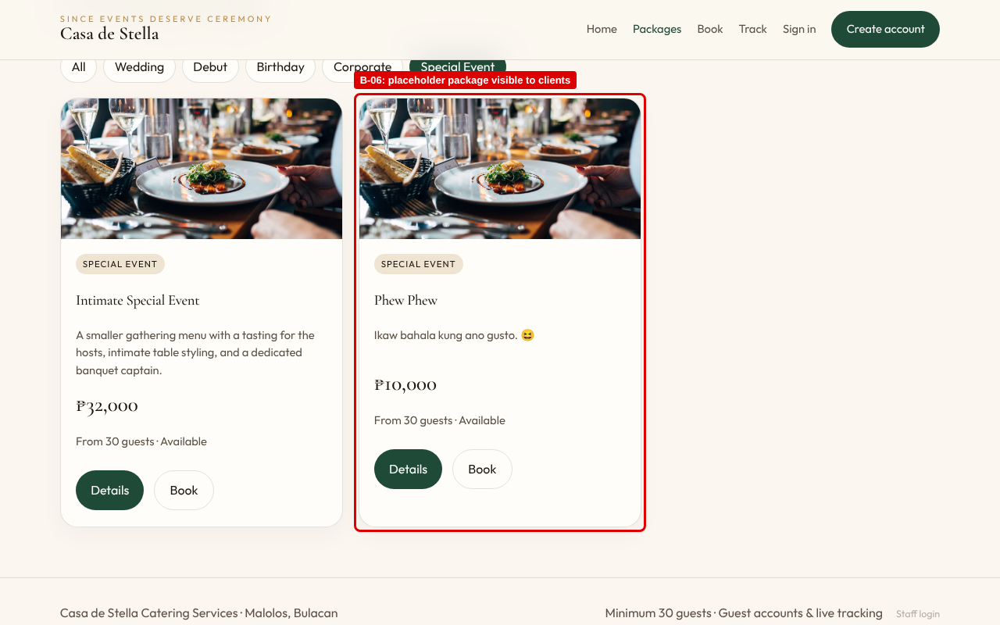

#### B-07 – The mobile header takes about 24% of the screen because the navigation wraps.

**Severity:** 2 (Medium) · **Heuristic:** #8 Aesthetic and minimalist design; #7 Flexibility and efficiency of use

**Steps to reproduce:** Open the site on a 390 px-wide phone → any page.

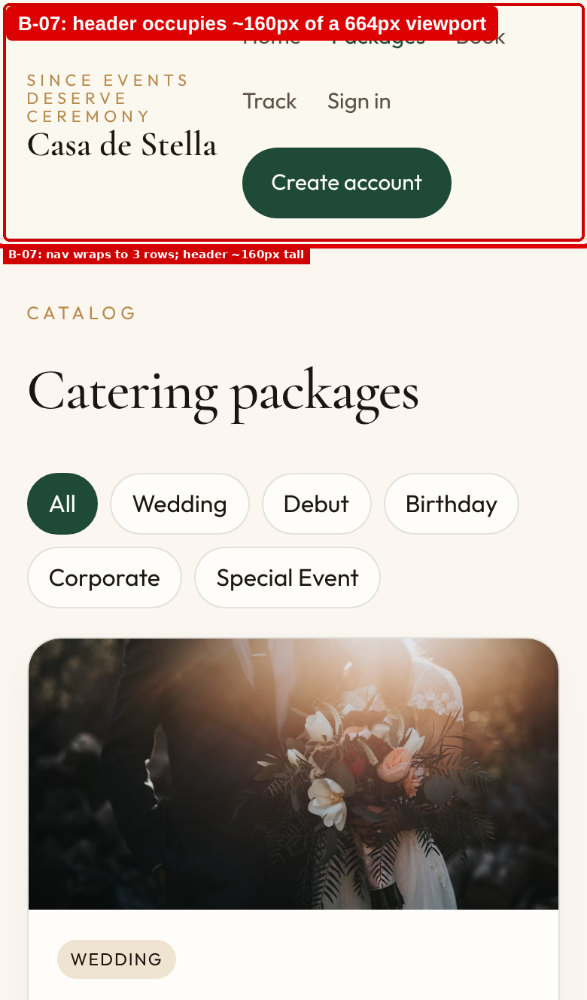

#### B-08 – Old-style numerals make counts and prices hard to read.

**Severity:** 2 (Medium) · **Heuristic:** #6 Recognition rather than recall (legibility / accessibility)

**Steps to reproduce:** Sign in → Dashboard → Reservations / Pending / Confirmed / Completed counters.

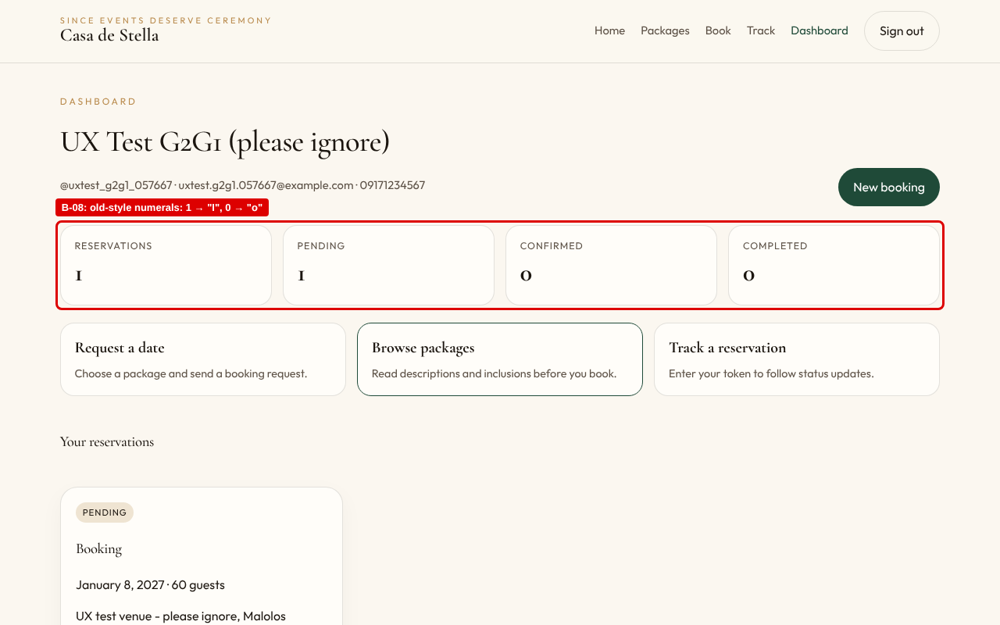

#### B-09 – Labels assume Gmail, and the OTP request button is placed out of sequence.

**Severity:** 2 (Medium) · **Heuristic:** #2 Match between system and the real world; #5 Error prevention

**Steps to reproduce:** Sign in → Forgot password? → read the labels and button order.

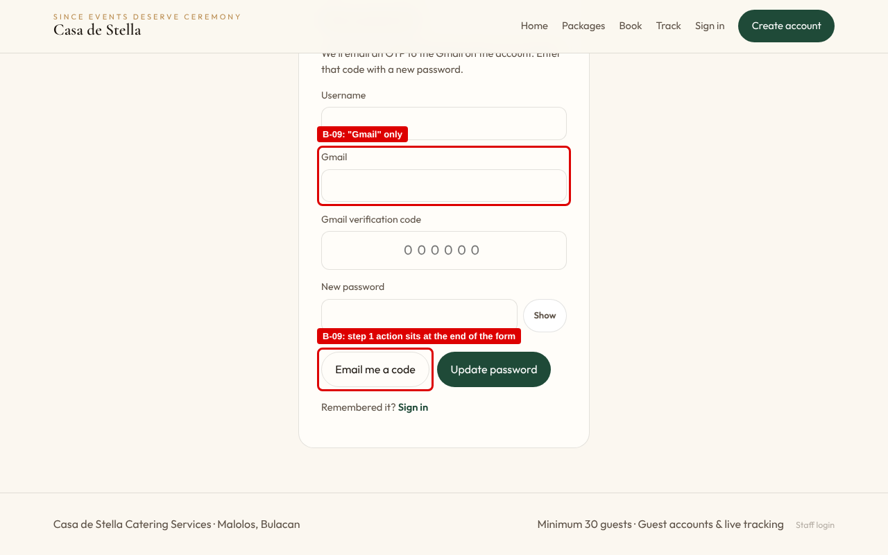

#### B-10 – The tracking page shows a bare status with no guidance.

**Severity:** 1 (Minor) · **Heuristic:** #10 Help and documentation; #1 Visibility of system status

**Steps to reproduce:** Track → paste the tracking token → Look up.

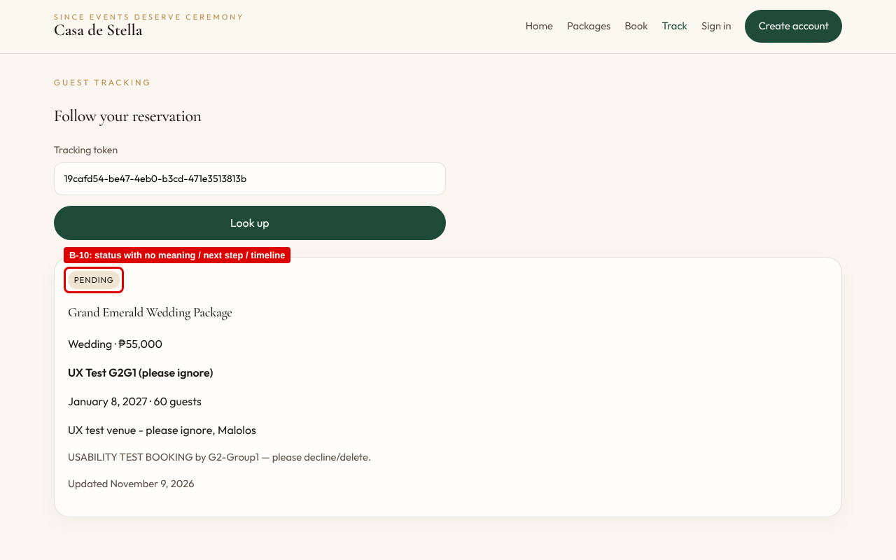

#### B-11 – The page title never changes and inner views have no h1.

**Severity:** 1 (Minor) · **Heuristic:** #4 Consistency and standards (accessibility, WCAG 2.4.2 Page Titled)

**Steps to reproduce:** Open Packages, Book and Track in separate tabs → compare tab titles; inspect the heading structure.

## Task 3: Severity Breakdown & Usability Friction Summary

**Total Bugs Identified by Severity:** Catastrophe (4): 0 | Major (3): 2 | Medium (2): 7 | Minor (1): 2 | **Total: 11**

**Primary Usability Blocker Summary** *(the #1 issue preventing task completion)*:

> The booking flow does not give guests enough information to commit with confidence (B-02, with B-01 after booking). On the booking form, the guest sees only a base price and a minimum headcount. No estimate is shown for the actual guest count, and the site never says whether the price is flat or per head. After submitting, the Dashboard lists the reservation only as "Booking", so the guest cannot confirm which package they reserved. Together these break Match between system and the real world and Recognition rather than recall. They are the main reason a guest would abandon or cancel a request instead of completing it.

## Task 4: High-Fidelity Prototype Refinement Action Plan

To address the documented usability friction, our group developed a targeted high-fidelity UI/UX refinement plan. Each proposed solution resolves a logged heuristic violation so that the system is ready for final software implementation.

| Bug ID | Identified Friction Point | Proposed High-Fidelity UI/UX Refinement | Expected Outcome |
|---|---|---|---|
| B-01 | Reservation cards on the guest Dashboard show "Booking" instead of the package name. | Show the package name, category and base price on every reservation card, plus the booking number (e.g., "#19 · Grand Emerald Wedding Package"). If the bookings endpoint does not embed the package, look it up by packageId from the package list the Dashboard already loads. | Guests identify each reservation at a glance and no longer open every token to find the right event. |
| B-02 | No cost estimate; pricing basis (flat vs. per head) is unstated. | Add a sticky "Booking summary" panel beside the form showing package, base price, guests included, additional guests × rate, and estimated total, updated live as the guest count changes. Reword price labels on cards to "₱55,000 for up to 50 guests". If the final quote is set by staff, say so in the panel: "Final quote confirmed by the events team." | Guests understand the cost before they commit to a date request, which reduces abandoned or cancelled requests. |
| B-03 | The "How to book" guide does not match the real flow, which requires an account. | Insert "2. Create a free account or sign in" into the guide (five steps). For signed-out visitors, label the call to action "Sign in to book". On the sign-in wall, add one line explaining why an account is needed (status updates, saved tracking tokens) and confirm that the chosen package will be kept after sign-in. | Expectations match the real flow, so the sign-in requirement no longer surprises guests and fewer leave at the wall. |
| B-04 | The confirmation is easy to miss and the form can be resubmitted. | After a successful submit, replace the form with a dedicated confirmation view scrolled to the top. Show a booking summary, the tracking token with a "Copy" button, and "Go to Dashboard" and "Track this booking" buttons. Disable or remove the submit button once the request succeeds. | Guests always see the confirmation, keep their token, and cannot create duplicate reservations by mistake. |
| B-05 | Generic "Please match the requested format" messages that do not state the rule. | Add helper text under each constrained field (e.g., "09XXXXXXXXX or +639XXXXXXXXX", "3–32 characters, starts with a letter"). Replace the native message with a specific inline error using setCustomValidity, and strip spaces and dashes from phone numbers before validating. | Guests fix input errors on the first try, and correctly formatted numbers are no longer rejected. |
| B-06 | A placeholder package is visible to and bookable by clients. | Unpublish the test package now. Add a Draft/Published status to the staff Package Manager so new packages stay hidden from guests until a staff member publishes them. | The catalog looks professional and guests cannot book a package that does not exist. |
| B-07 | The mobile header takes about 24% of the screen because the navigation wraps. | Below 860 px, collapse the navigation into a menu button that opens a drawer, hide the "Since events deserve ceremony" tagline, and keep a single visible "Book" call to action. | Phone users see package content immediately and can reach every page in two taps. |
| B-08 | Old-style numerals make counts and prices hard to read. | Apply font-variant-numeric: lining-nums tabular-nums to the counters, prices and dates, or set those numbers in the body font (Outfit). | Counts and prices are read correctly at a glance, including by users with low vision. |
| B-09 | Labels assume Gmail, and the OTP request button is placed out of sequence. | Rename the labels to "Email" and "Verification code". Split the form into two steps: (1) username + email → "Send code"; (2) reveal the code and new-password fields with a resend countdown. | Non-Gmail users are not confused, and the recovery steps follow the order the user actually has to do them. |
| B-10 | The tracking page shows a bare status with no guidance. | Add a status stepper (Pending → Confirmed → Completed, with Declined/Cancelled shown as end states), a one-line description of each status, the expected review time, and contact details for questions. | Guests know where their request stands and what to expect, which means fewer follow-up calls to staff. |
| B-11 | The page title never changes and inner views have no h1. | Set document.title on each route (e.g., "Book a date · Casa de Stella"), promote each view's heading to h1, and move focus to that heading after navigation. | Tabs and history entries are identifiable, and assistive technology announces page changes. |

## Laboratory Evaluation Conclusion

Overall, the Casa de Stella Catering client system has a solid operational foundation. All five task scenarios could be completed on the live deployment: browsing and filtering packages, registering, submitting a booking request, tracking it by token and from the Dashboard, and recovering an account. Validation rules from the SRS (7-day lead time, package minimum headcount, Philippine mobile format) work as specified. No catastrophic defects were found. The two major issues concern information the guest needs to commit to and recognize a booking: a missing cost estimate and an unnamed reservation card. The medium issues are mostly about expectation-setting, error messaging, a leftover test package and the mobile header. Implementing the refinements above will make the booking flow more transparent, forgiving and mobile-friendly while keeping the existing look of the site.

## Evaluation Rubric (100 Points)

| Criteria | Detailed Evaluation Standards | Points |
|---|---|---|
| Usability Testing Execution (30%) | Execution of at least 3 distinct task scenarios on peer prototype; clear documentation of test environment, roles, and user feedback. | 30 pts |
| Bug Analysis & Heuristic Rigor (30%) | Accurate identification of navigation friction points, UI flaws, and accessibility issues; correct mapping to Nielsen's 10 Usability Heuristics. | 30 pts |
| Severity Rating & Evidence Quality (20%) | Objective assignment of severity ratings (0-4) with clear evidence (steps to reproduce, screen names, annotated screenshots). | 20 pts |
| Refinement Action Plan (10%) | Actionable, high-fidelity UI/UX solutions proposed for identified bugs with expected usability improvements. | 10 pts |
| Documentation & Professionalism (10%) | Clean structure, professional visual presentation, complete tables, and zero typographical errors. | 10 pts |
