# SCLS UML Diagram Set

**System:** Smart Campus Logistics System (SCLS) — Document Custody & Approval Tracker
**Course:** CPE 304L — Software Design | **Group:** Group 2-1

All diagrams are Mermaid and are consistent with the SRS (`docs/03-srs/srs-campus-logistics.md`) and the Activity 2 data model (`docs/06-data-modeling/`). Rendered PNGs of every diagram are in `diagrams/`.

| # | UML Diagram | Category | Mermaid Type |
| --- | --- | --- | --- |
| 1 | Use Case | Behavioral | `flowchart` (UML notation approximated) |
| 2 | Class | Structural | `classDiagram` |
| 3 | Object | Structural | `classDiagram` (instance snapshot) |
| 4 | Package | Structural | `flowchart` with subgraphs |
| 5 | Component | Structural | `flowchart` with subgraphs |
| 6 | Deployment | Structural | `flowchart` with subgraphs |
| 7 | Sequence (×5) | Interaction | `sequenceDiagram` |
| 8 | Activity (×2) | Behavioral | `flowchart` |
| 9 | State Machine (×3) | Behavioral | `stateDiagram-v2` |
| 10 | Entity-Relationship | Data | `erDiagram` |

Mermaid has no native notation for UML communication, timing or interaction-overview diagrams, so those are not included.

---

## 1. Use Case Diagram

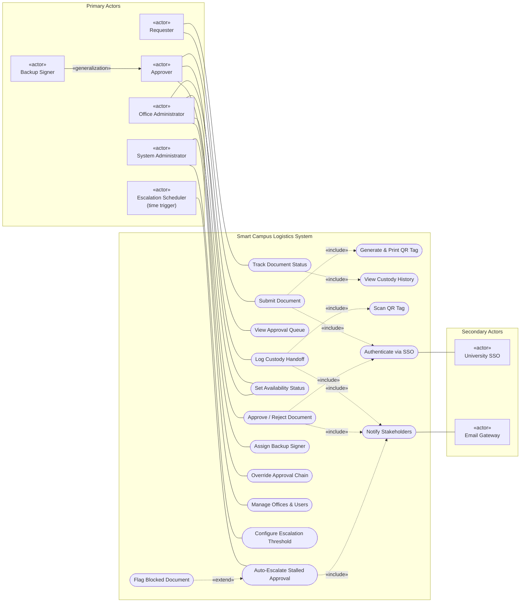

---

## 2. Class Diagram (upgraded domain model)

Upgraded from the Quiz 1 baseline (Document, CustodyLogEntry, Approver, Office). Each class maps 1:1 to a table in the Activity 2 schema.

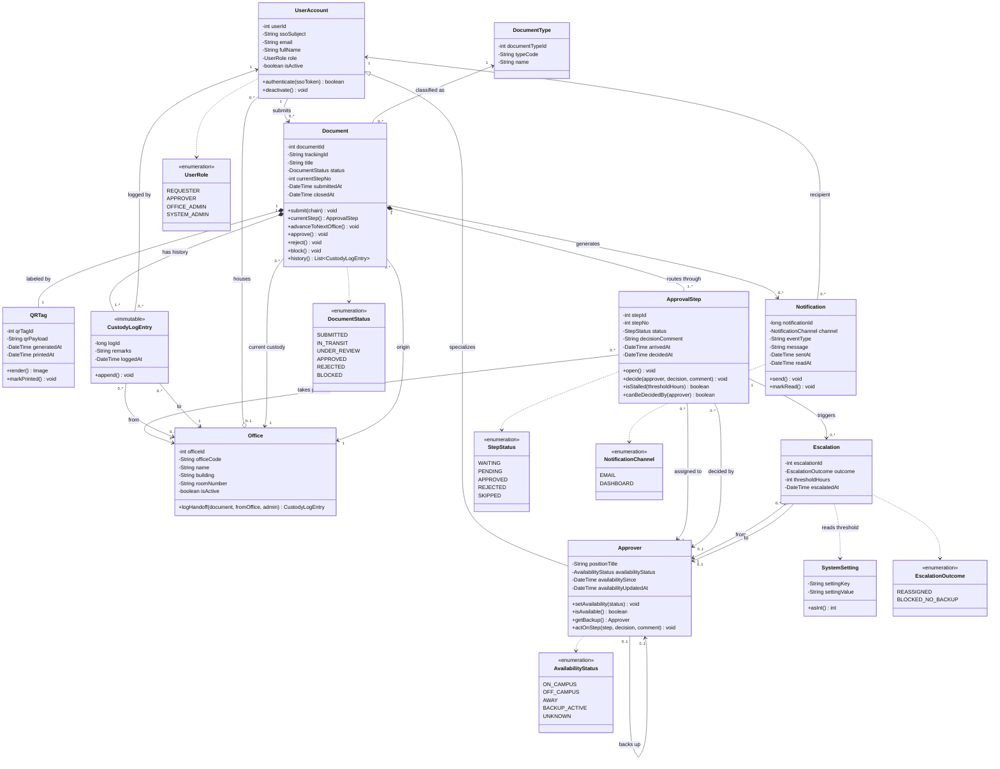

---

## 3. Object Diagram (snapshot: a Leave of Absence form mid-route, escalated)

State at 2026-11-11 09:00: the department head has been Off-Campus for 30 h, so step 1 was escalated to the dean (the backup), who approved it. The document is now under review at the Registrar.

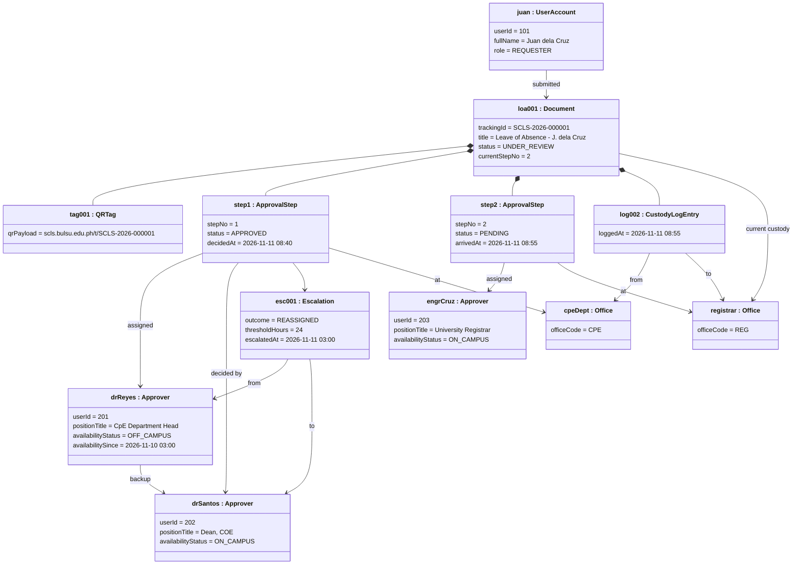

---

## 4. Package Diagram

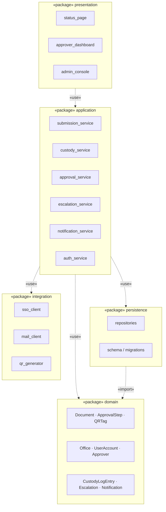

---

## 5. Component Diagram

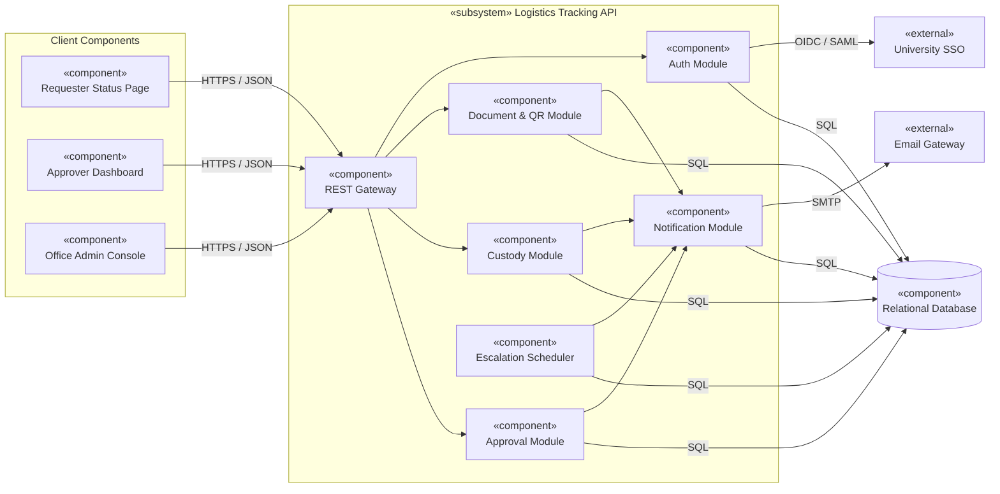

---

## 6. Deployment Diagram

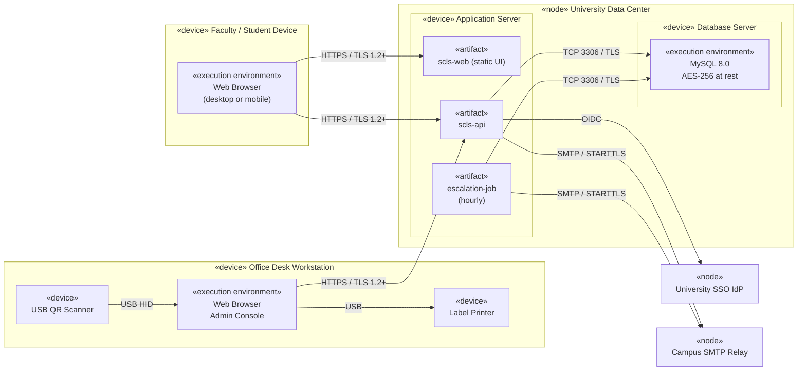

---

## 7. Sequence Diagrams

### 7.1 Submit Document (SRS 3.2.1)

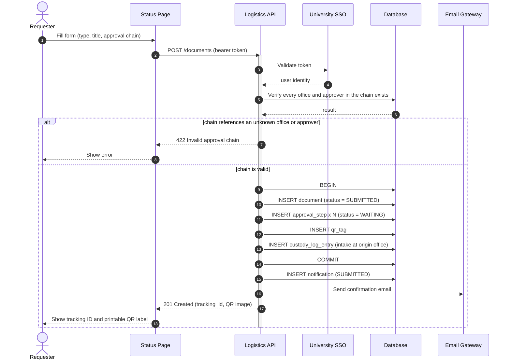

### 7.2 Log Custody Handoff by QR Scan (SRS 3.2.2)

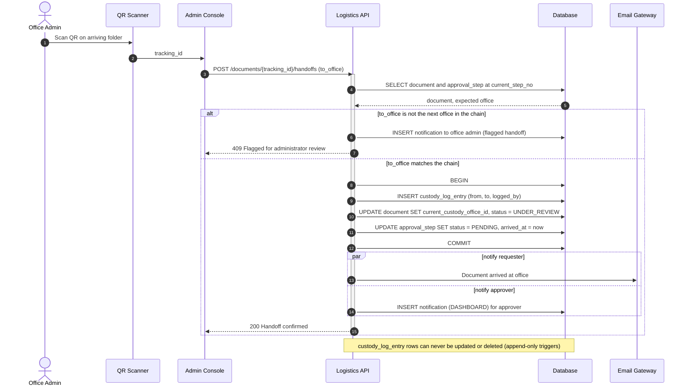

### 7.3 Approve or Reject (SRS 3.2.4)

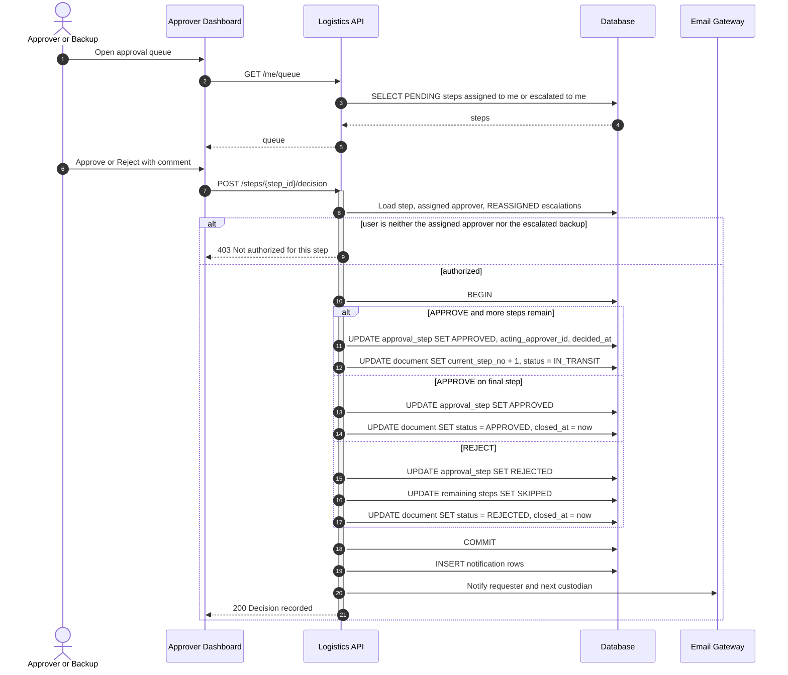

### 7.4 Automatic Escalation (SRS 3.2.5)

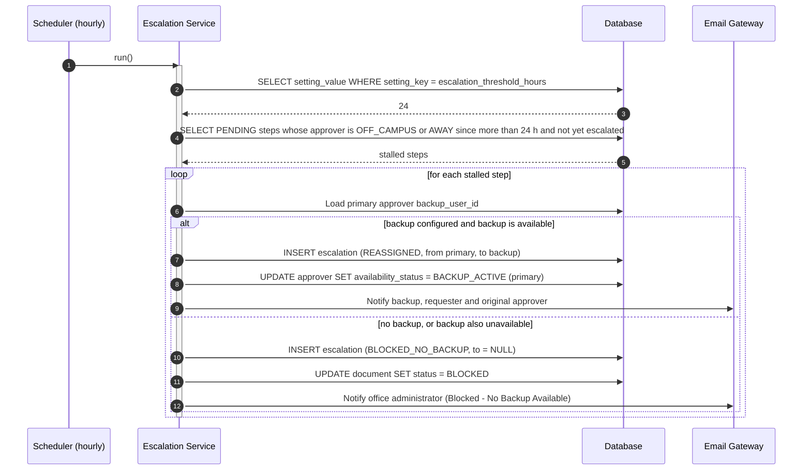

### 7.5 Track Document Status (SRS 3.2.6)

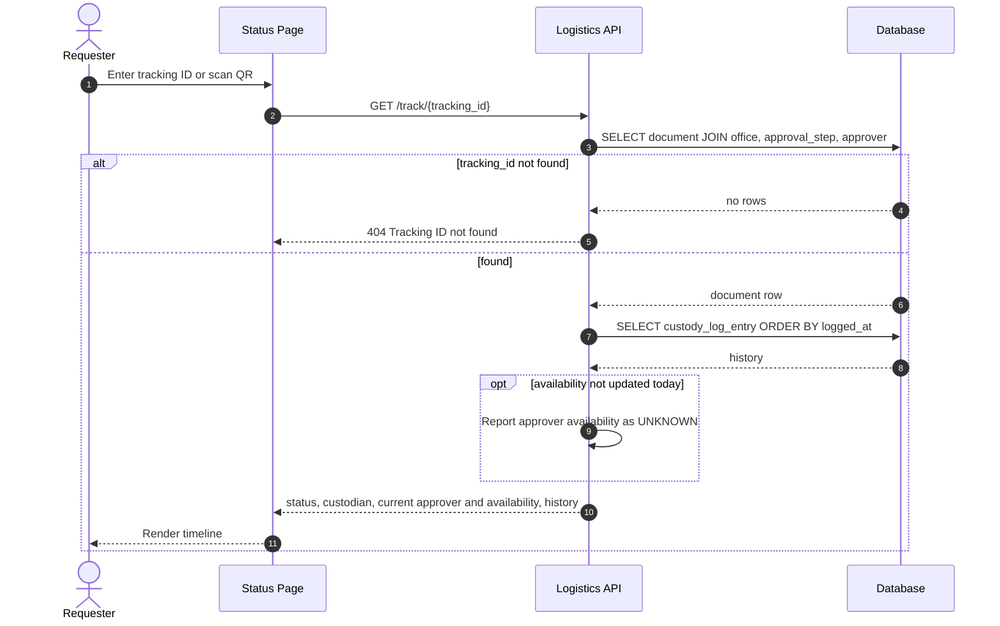

---

## 8. Activity Diagrams

### 8.1 End-to-End Document Routing

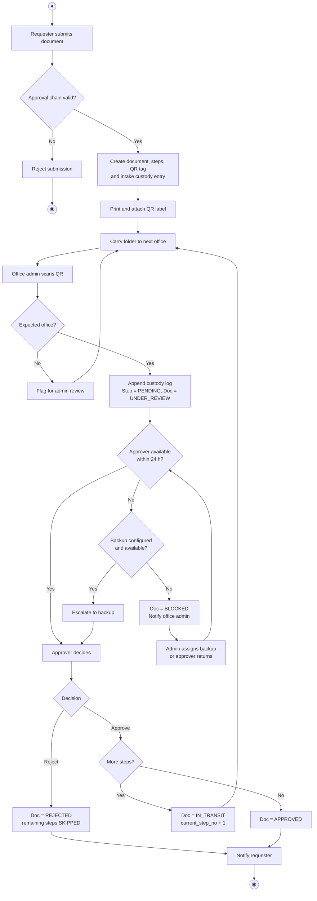

### 8.2 Hourly Escalation Job

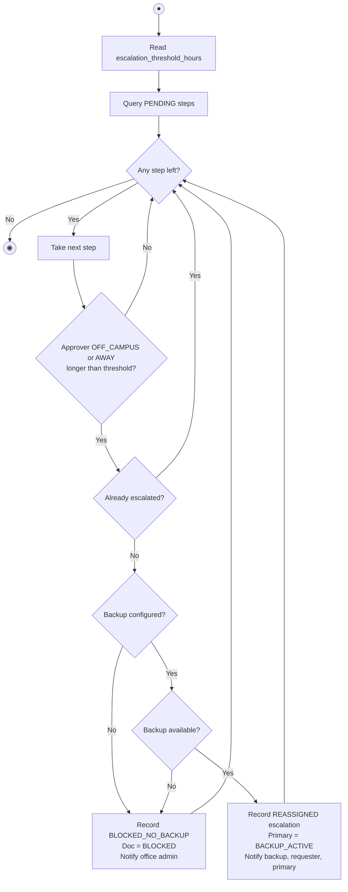

---

## 9. State Machine Diagrams

### 9.1 Document Lifecycle

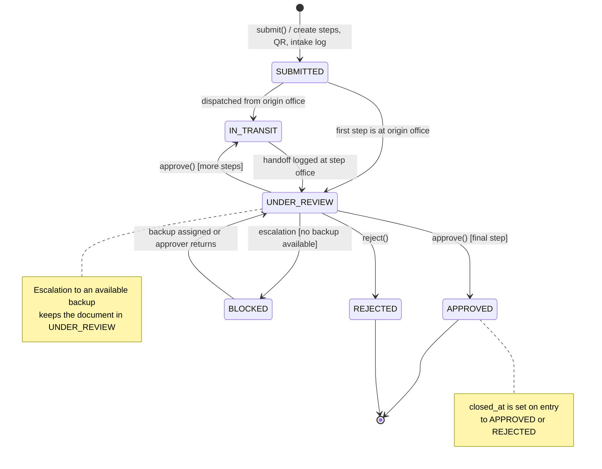

### 9.2 Approval Step

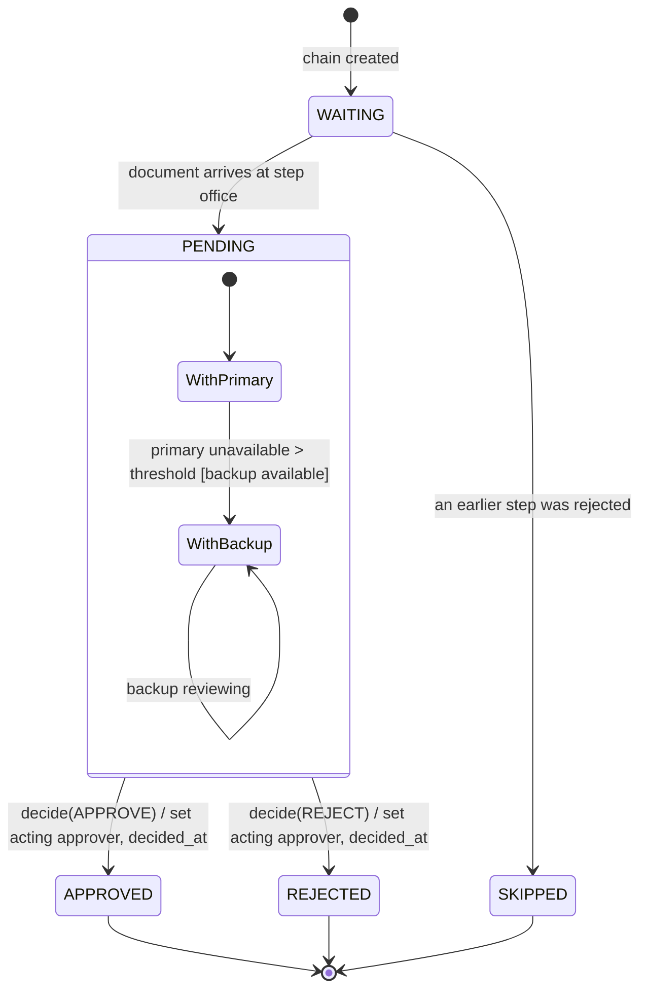

### 9.3 Approver Availability

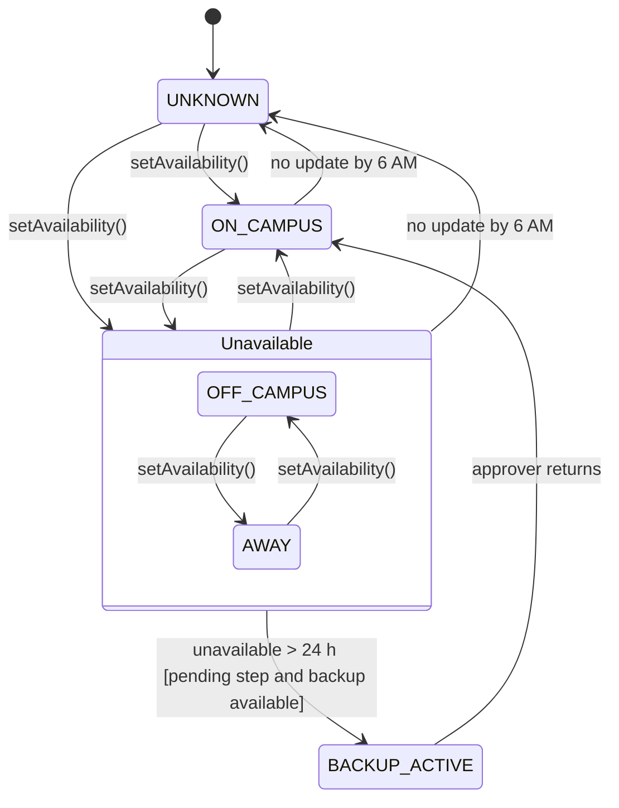

---

## 10. Entity-Relationship Diagram

The full crow's-foot ERD with all columns is in `docs/06-data-modeling/data-modeling-scls.md` (Task 2). Summary view:

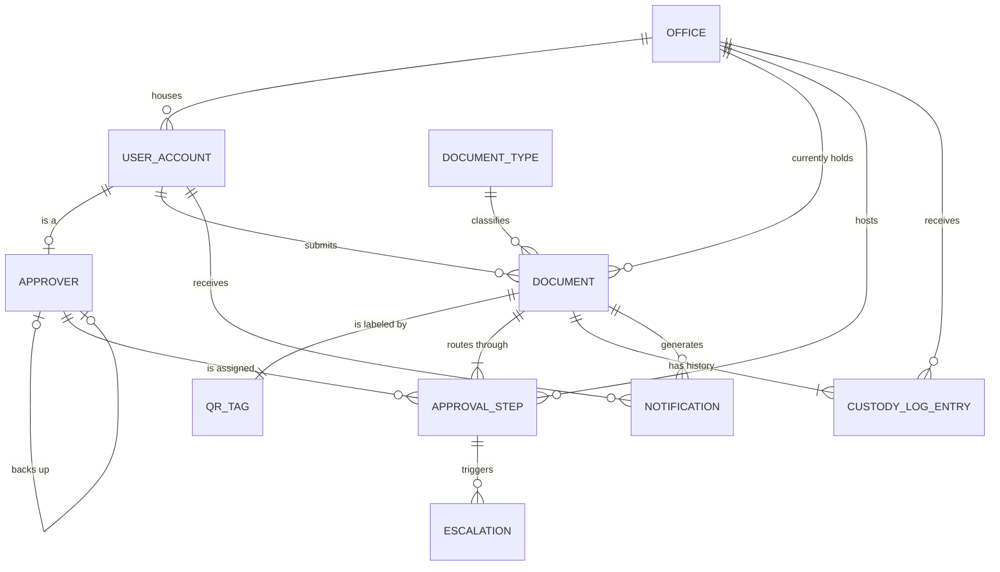
